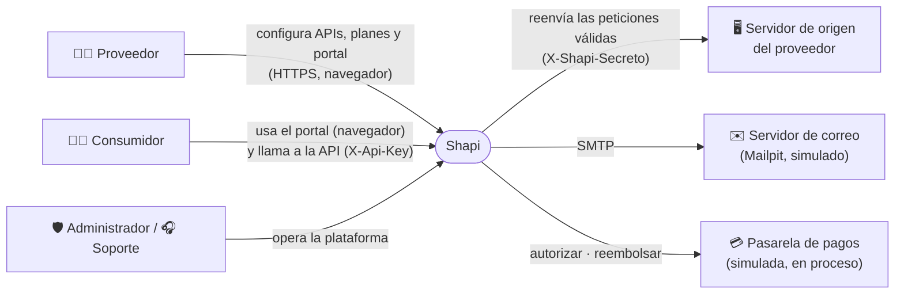
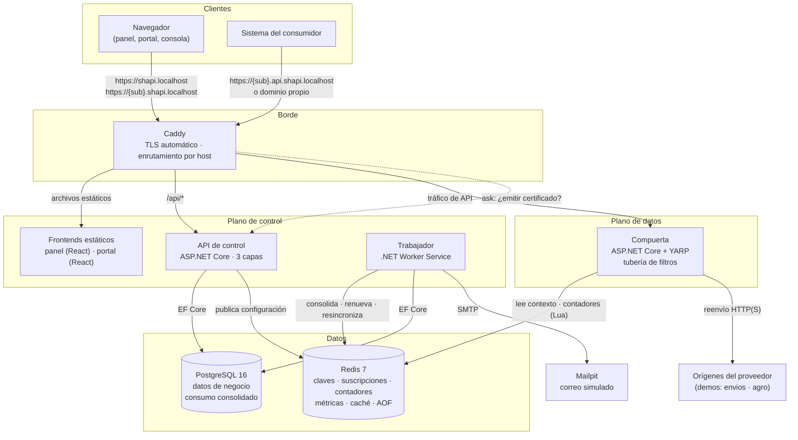
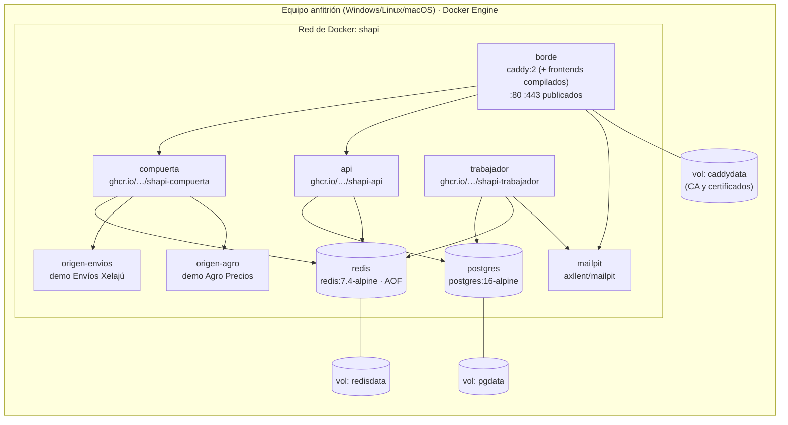

# 1. Introducción

Este manual técnico describe **Shapi**, la plataforma como servicio que el equipo 6 desarrolló como proyecto final de Ingeniería de Software I de la Universidad Rafael Landívar, campus de Quetzaltenango, en el segundo ciclo de 2026.

El manual está dirigido a quien tenga que **entender, instalar, operar o continuar** el sistema: la docente del curso, los integrantes del equipo y cualquier desarrollador que reciba el proyecto. Reúne en un solo documento qué hace el sistema, cómo está construido, cómo se planificó y cómo se instala, configura, respalda y recupera.

## 1.1 Organización del documento

| Capítulos | Contenido |
|---|---|
| 1 a 5 | El sistema: descripción, objetivos, alcance y requisitos funcionales y no funcionales |
| 6 y 7 | Cómo se construyó: la arquitectura y el modelo de proceso de desarrollo |
| 8 | El cronograma pronosticado y el real |
| 9 y 10 | El diseño: las pantallas aprobadas (mockups) y los diagramas UML, de flujo y de la base de datos |
| 11 a 14 | La operación: tecnologías, instalación, problemas frecuentes y respaldo de los datos |
| 15 | Anexos: variables de entorno, cuentas de demostración, puertos y estructura del repositorio |

## 1.2 Documentos relacionados

Este manual resume y enlaza las **especificaciones** del proyecto, que son la fuente de verdad: si el código las contradice, el código está mal. Están en `docs/specs/` del repositorio y se entregan también en PDF:

- **Documento de Requisitos** (`docs/pdf/Documento_de_Requisitos.pdf`): visión y alcance, glosario, requisitos, roles y permisos, y casos de uso.
- **Documento de Diseño** (`docs/pdf/Documento_de_Diseno.pdf`): arquitectura, modelo de datos, compuerta, cobros y suscripciones, identidad y seguridad, interfaz y decisiones de diseño (ADR).
- **Manual de Usuario** (`docs/pdf/Manual_de_Usuario.pdf`): el uso del sistema por cada actor.

El código fuente está en el repositorio [github.com/jordin-garcia/shapi](https://github.com/jordin-garcia/shapi).

## 1.3 Convenciones

- Los comandos se escriben en bloques de código y se ejecutan **desde la raíz del repositorio**, salvo que se indique otra carpeta.
- Cuando un comando cambia entre sistemas operativos, se dan las dos versiones: **PowerShell** (Windows) y **bash** (Linux, macOS o Git Bash).
- Los requisitos se citan por su código (`RF-xx` funcionales y `RNF-xx` no funcionales); las pantallas, por su código de mockup (por ejemplo, A3.2); y las decisiones de diseño, por su número de ADR.
- Los montos están en quetzales (Q) y las fechas y horas, en la hora de Guatemala.

# 2. Descripción del sistema

Shapi es una plataforma como servicio que permite a una empresa **publicar su API, controlar quién la usa y cobrar por ella, sin modificar el servidor que ya tiene**. La empresa conecta su servidor, sube su especificación OpenAPI y define planes. Shapi le crea un portal con la marca de esa empresa, emite las claves de acceso, aplica las cuotas en cada petición y registra el consumo y los pagos.

## 2.1 Categoría del enunciado

De las tres categorías del enunciado del curso se eligió **Servidores Web como Servicio**, y la docente aprobó la propuesta. El recurso que se contrata es un **entorno web gestionado por API**, que Shapi crea, configura y monitorea desde una interfaz web. Cada entorno tiene un subdominio para el portal y otro para la API (ambos con certificado TLS), el enrutamiento hacia el servidor de origen, un portal web alojado por la plataforma y el monitoreo de peticiones, latencia, errores y datos transferidos.

| Lo que exige el enunciado | Cómo lo cumple Shapi |
|---|---|
| Crear entornos web | Cada API registrada crea un entorno con subdominio, certificado, rutas y portal (RF-08 a RF-11) |
| Gestionar configuraciones | Origen, rutas, límites, caché, planes, claves, marca, dominio propio y secreto de origen |
| Gestión de dominios simulados | Subdominios bajo `shapi.localhost` y dominios propios verificados con un DNS simulado |
| Monitorear el consumo de recursos | Peticiones, llamadas, latencia p95, errores por código y bytes transferidos (RF-35) |

## 2.2 Problema y justificación

Una empresa que ya tiene un servicio funcionando puede convertirlo en un ingreso. Pero entre un servidor que responde y un producto que alguien pueda contratar siempre hay que construir lo mismo: claves, límites de uso, medición, documentación, planes y cobro. Esa parte no diferencia a nadie y cuesta semanas de trabajo.

Hay plataformas internacionales que ya lo resuelven, pero cobran a través de pasarelas que no admiten empresas guatemaltecas, o imponen su marca y se quedan con una comisión del 20 % al 25 %. La propuesta de valor de Shapi es:

- una suscripción fija, sin comisión;
- el portal conserva la marca del proveedor;
- la interfaz está en español;
- el cobro queda detrás de una interfaz de pasarela de pagos (`IPasarelaPagos`). En esta versión académica la pasarela es un **simulador**, como permite el enunciado, y la arquitectura permite conectar después una pasarela local sin cambiar el resto del sistema.

## 2.3 Actores

| Actor | Quién es | Dónde trabaja |
|---|---|---|
| **Proveedor** | La empresa que publica y cobra su API. Es el **cliente** de Shapi. Dentro de su organización, cada persona es propietario, editor o lector | Panel de Shapi (`shapi.localhost/panel`) |
| **Consumidor** | El desarrollador o la empresa que contrata un plan y usa la API. Su cuenta pertenece a la organización proveedora; no se registra en Shapi | Portal de marca blanca (`{sub}.shapi.localhost`) y la API (`{sub}.api.shapi.localhost`) |
| **Administrador** | Quien opera la plataforma | Panel de administración (`shapi.localhost/admin`) |
| **Soporte** | Quien atiende los casos de los proveedores, con acceso de solo lectura a los datos de las organizaciones | Panel de administración, con menos opciones |
| **Sistema** | Los procesos automáticos: la compuerta y el trabajador en segundo plano | Sin interfaz |

## 2.4 Funcionamiento

**El proveedor:**
1. Se registra, confirma su correo y su organización queda en el plan **Prueba** (30 días, sin tarjeta).
2. Registra una API con un nombre, la URL de su servidor de origen y un subdominio que él elige. Shapi prueba la conexión con el origen antes de guardar.
3. Sube su especificación OpenAPI. Shapi extrae las rutas y el proveedor decide cuáles expone.
4. Configura cada ruta (límite por minuto, caché y peso en llamadas) y personaliza el portal (logotipo, color, nombre y texto de bienvenida).
5. Define los planes de su API y la publica.
6. Consulta el consumo, la facturación por consumidor y su historial de pagos. Puede invitar miembros y consumidores, y abrir casos de soporte.

**El consumidor:**
1. Entra al portal del proveedor, revisa la documentación y crea su cuenta, o acepta una invitación.
2. Confirma su correo, elige un plan y paga con tarjeta. Los planes gratuitos no piden tarjeta.
3. Recibe una clave de producción y una de pruebas, que se muestran completas una sola vez.
4. Llama a la API con la cabecera `X-Api-Key`. Desde el portal consulta su consumo por ruta y sus pagos, rota o revoca sus claves y cambia de plan.

**Los procesos automáticos:**
- **La compuerta** valida cada petición contra Redis, aplica los límites y las cuotas, reenvía la petición al origen y registra las métricas.
- **El trabajador** consolida las métricas en PostgreSQL cada 10 segundos; cierra los ciclos de las suscripciones y las renueva, las pone en gracia o las suspende; envía los correos pendientes, y verifica los dominios propios.

## 2.5 Modelo de negocio

Shapi cobra una **suscripción fija** a cada proveedor, sin comisión. Cada proveedor define además los planes que vende a sus consumidores (dos niveles de planes), y Shapi les cobra a los consumidores por cuenta del proveedor.

| Plan de plataforma | Precio | Vigencia | APIs | Peticiones por ciclo | Miembros | Dominio propio |
|---|---|---|---|---|---|---|
| Prueba | Q 0.00 | 30 días, no se renueva | 1 | 10,000 | 1 | No |
| Lanzamiento | Q 199.00 | 30 días | 3 | 250,000 | 3 | No |
| Producto | Q 599.00 | 30 días | 10 | 2,000,000 | 10 | Sí |
| Escala mensual | Q 1,500.00 | 30 días | Sin límite | 10,000,000 | Sin límite | Sí |
| Escala anual | Q 15,000.00 | 365 días | Sin límite | 120,000,000 | Sin límite | Sí |

La cuota de plataforma se cuenta en **peticiones** y no en llamadas, para que el proveedor no pueda saltársela poniéndoles peso 0 a sus rutas.

# 3. Objetivos

## 3.1 Objetivo general

Diseñar, desarrollar, documentar e implementar una plataforma como servicio que permita a una empresa publicar su API, administrar a sus consumidores mediante planes y claves de acceso, y cobrar por su uso desde un portal con su propia marca.

## 3.2 Objetivos específicos

1. Levantar los requisitos funcionales y no funcionales del sistema y modelar los casos de uso de sus actores: proveedor, consumidor, administrador, soporte y sistema.
2. Diseñar la arquitectura, el modelo entidad-relación y la base de datos, y justificar cada decisión.
3. Implementar la gestión de usuarios: registro, verificación de correo, recuperación de contraseña, autenticación con sesiones y control de roles, tanto para el personal como para los consumidores.
4. Desarrollar la compuerta de tráfico: validar claves, aplicar límites por minuto y cuotas, y medir el consumo de cada consumidor.
5. Implementar las suscripciones y los pagos: ver planes, contratar, historial de pagos, renovación automática, gracia y suspensión, con una pasarela simulada.
6. Generar automáticamente, a partir de la especificación OpenAPI de cada proveedor, un portal de marca blanca con documentación y consola de pruebas.
7. Desplegar el sistema en un ambiente productivo simulado y reproducible, y elaborar el manual técnico y el manual de usuario.

# 4. Alcance

## 4.1 Incluido

- Gestión de usuarios con registro, verificación de correo, recuperación de contraseña, sesiones, roles y organizaciones, **tanto para el personal como para los consumidores**.
- Publicación de APIs con especificación OpenAPI, rutas expuestas, subdominios, dominio propio verificado con DNS simulado y secreto de origen.
- Un portal de marca blanca por API, con inicio, documentación generada, consola de pruebas, planes y la cuenta del consumidor.
- La compuerta: validación de claves, límites por minuto, cuotas del consumidor y de la plataforma, caché opcional, reenvío al origen y medición.
- Planes en dos niveles, contratación con pasarela simulada, cambio de plan con prorrateo, renovación automática, periodo de gracia, suspensión y reversión de pagos.
- Paneles de consumo para el proveedor y el consumidor, el panel de administración, la bandeja de casos de soporte (del lado del proveedor y del lado de soporte), el estado de los componentes y la bitácora de acciones sensibles.
- Notificaciones por correo a través de un servidor de correo simulado (Mailpit).
- Un **modo demostración** con un reloj de negocio que se puede adelantar, para mostrar renovaciones, gracia y suspensiones sin esperar 30 días.
- Despliegue reproducible con Docker Compose en un **ambiente productivo simulado**, con los datos de demostración de los mockups.

## 4.2 Excluido

- Integración con un procesador de pagos real. Se usa la pasarela simulada que permiten los lineamientos.
- Liquidarle al proveedor lo que cobran sus consumidores.
- Emisión de documentos tributarios electrónicos.
- Dominios y certificados públicos reales. Todo corre en `*.localhost` con la autoridad certificadora interna del borde.
- Un mercado público de APIs: el portal siempre es de marca blanca.
- Ejecución de código subido por los clientes. La plataforma solo enruta tráfico.
- Verificación en dos pasos.
- Que un usuario pertenezca a más de una organización o que se transfiera la propiedad de una organización.
- Que el consumidor cancele la renovación automática o que el proveedor bloquee a un consumidor completo (el proveedor revoca claves y las suspensiones solo ocurren por falta de pago).
- Bibliotecas propias por lenguaje, alta disponibilidad en varias regiones y aplicación móvil.

## 4.3 Restricciones

- El presupuesto es **Q 0.00**: no se compran dominios, servidores ni servicios.
- El stack es el que permiten los lineamientos: .NET 10 (ASP.NET Core), React y PostgreSQL. También se usan Redis, YARP y Caddy.
- Las entregas son el Avance 1 (30 %) el 25 de septiembre, el Avance 2 (50 %) el 9 de octubre, el Avance 3 (80 %) el 31 de octubre, como video, y la entrega final en la primera semana de noviembre de 2026.
- El desarrollo es **dirigido por especificaciones** y lo ejecutan agentes de inteligencia artificial bajo la supervisión del equipo (capítulo 7).

# 5. Requisitos funcionales y no funcionales

Los requisitos completos, con su actor, su criterio de aceptación y sus pantallas, están en `docs/specs/03-requisitos.md` y en el Documento de Requisitos. Aquí se listan con su código y su enunciado. Los códigos RF-01 a RF-42 conservan el número del documento de requisitos del 11 de septiembre; RF-43 a RF-47 se agregaron después.

## 5.1 Requisitos funcionales

### 5.1.1 Gestión de usuarios y acceso

| ID | Requisito |
|---|---|
| RF-01 | El sistema permitirá registrar un proveedor con nombre, correo, nombre de la organización y contraseña. Creará la organización, dejará al usuario como **propietario** y pondrá a la organización en el plan **Prueba** sin pedirle tarjeta. |
| RF-02 | El sistema enviará un enlace de verificación al correo del proveedor o del consumidor. El enlace vence a las 24 horas y puede pedirse de nuevo. Mientras no se confirme el correo, **el proveedor no puede publicar APIs y el consumidor no puede contratar planes**. |
| RF-03 | El sistema permitirá recuperar la contraseña con un enlace de un solo uso que vence a los 60 minutos. **Al usarlo se cierran todas las demás sesiones** de esa cuenta. |
| RF-04 | El sistema autenticará a los usuarios con correo y contraseña y mantendrá una sesión que vence tras un tiempo de inactividad configurable (8 h por defecto) o a los 7 días como máximo. El personal puede cerrar sesión, cambiar su nombre y cambiar su contraseña. |
| RF-05 | El sistema permitirá registrar consumidores desde el portal de una API o **por invitación que el proveedor envía desde su panel**. La invitación vence a los 7 días. |
| RF-06 | El sistema manejará estos roles: `administrador` y `soporte` en la organización de plataforma; `propietario`, `editor` y `lector` en las organizaciones proveedoras; y **consumidor** como identidad aparte. El propietario puede invitar miembros, cambiar su rol y quitarlos. |
| RF-07 | El sistema restringirá cada operación según el rol y la organización del usuario, conforme a la matriz de permisos. |

### 5.1.2 Publicación y configuración de APIs

| ID | Requisito |
|---|---|
| RF-08 | El sistema permitirá registrar una API con nombre, URL del servidor de origen y **subdominio**. Antes de guardar, validará la URL y **probará la conexión** con el origen. |
| RF-09 | El sistema permitirá cargar una especificación OpenAPI 3.0 o 3.1, en JSON o YAML y de hasta 2 MB, y extraerá sus rutas. **Si se vuelve a cargar**, las rutas que ya existían conservan su configuración, las nuevas quedan **ocultas** y las que ya no aparecen se eliminan. |
| RF-10 | El sistema permitirá marcar cada ruta como expuesta u oculta. |
| RF-11 | El sistema servirá cada API en dos hosts: `{sub}.api.{dominio_base}` para la API y `{sub}.{dominio_base}` para el portal. Los dos tendrán TLS **emitido y renovado automáticamente por el borde**. |
| RF-12 | El sistema permitirá conectar un **dominio propio a la API** si el plan de plataforma lo incluye. La propiedad del dominio se verifica con un registro CNAME que apunta a `{sub}.api.{dominio_base}`. En el entorno simulado, el registro se crea en el **DNS simulado** y el dominio debe terminar en `.localhost`. |
| RF-13 | El sistema permitirá configurar en cada ruta el **límite por minuto** (en peticiones; si se deja vacío, la ruta no tiene límite propio), la **caché** (en segundos, solo para GET; 0 la desactiva) y el **peso en llamadas** (1 o más). |
| RF-14 | El sistema permitirá publicar y despublicar una API sin eliminar sus datos. |
| RF-15 | El sistema permitirá personalizar el portal **de cada API** con logotipo (PNG o SVG de hasta 512 KB), color principal, nombre del portal y texto de bienvenida. |
| RF-16 | El sistema generará el portal automáticamente: inicio, documentación por ruta (descripción, parámetros y ejemplos sacados de la especificación, más el peso en llamadas) y consola de pruebas. **En la consola, el consumidor pega su clave de pruebas**, que solo se recuerda mientras la pestaña esté abierta. |

### 5.1.3 Suscripciones y pagos

| ID | Requisito |
|---|---|
| RF-17 | El sistema permitirá al administrador crear y editar planes de plataforma con nombre, descripción, precio, vigencia en días, máximo de APIs, máximo de miembros, cuota de peticiones y si incluyen dominio propio. |
| RF-18 | El sistema permitirá al proveedor crear y editar planes de API con nombre, descripción, precio, vigencia, cuota de llamadas por ciclo y límite de peticiones por minuto, y marcarlos como gratuitos. |
| RF-19 | El sistema mostrará los planes disponibles al proveedor y al consumidor antes de contratar. |
| RF-20 | El sistema permitirá contratar un plan con tarjeta y activará la suscripción **en el momento en que la pasarela autorice el cobro**. Los planes gratuitos se activan sin pedir tarjeta. Si el cobro se rechaza, no se crea la suscripción y la suscripción vigente no cambia. |
| RF-21 | El sistema registrará el historial de pagos de cada organización y de cada consumidor. |
| RF-22 | El sistema renovará automáticamente las suscripciones al cerrar cada ciclo, cobrando al medio de pago registrado. |
| RF-23 | El sistema aplicará un **periodo de gracia de 7 días** cuando se rechace el cobro de una renovación y **suspenderá** la suscripción si no se paga en ese plazo. Mientras dure la gracia, el servicio sigue funcionando. Si se suspende la plataforma de una organización, **todas sus APIs responden 403**; si se suspende la suscripción de un consumidor, **sus claves responden 403**. Un cobro autorizado reactiva la suscripción con un ciclo nuevo desde ese día. |
| RF-24 | El sistema permitirá al administrador **revisar los pagos de plataforma y revertir** un cobro autorizado. |
| RF-25 | El sistema permitirá cambiar de plan. **Subir** de plan se cobra prorrateado y se aplica de inmediato. **Bajar** de plan se aplica en la siguiente renovación, sin reembolso. **No se puede bajar** a un plan si la organización excede sus límites (por ejemplo, si tiene más APIs publicadas de las que el plan permite). Si el plan de destino no incluye dominio propio, los dominios se desconectan al aplicar el cambio; hasta entonces se conservan. |

### 5.1.4 Compuerta de tráfico

| ID | Requisito |
|---|---|
| RF-26 | El sistema emitirá una clave de producción y una de pruebas al activarse una suscripción de API y **las mostrará completas una sola vez**. |
| RF-27 | El sistema permitirá **al consumidor** rotar una de sus claves. La clave nueva se muestra una sola vez y la anterior sigue funcionando 24 horas. |
| RF-28 | El sistema permitirá revocar una clave, al **consumidor** si es suya y al **proveedor** si es de uno de sus consumidores. La revocación se hace efectiva en **menos de 10 segundos**. Después de revocar una clave, el consumidor puede emitir una nueva del mismo tipo. |
| RF-29 | El sistema validará en cada petición que la API esté publicada, la clave, el estado de la organización, el estado de la suscripción y que la ruta esté expuesta. Rechazará con **404, 401 o 403** según corresponda. |
| RF-30 | El sistema rechazará con **429** las peticiones que superen el límite por minuto (del plan o de la ruta), las que agoten la cuota del consumidor y las que agoten la cuota de plataforma del proveedor. |
| RF-31 | El sistema reenviará al origen solo las peticiones que pasen todos los filtros. Antes de reenviarlas quitará `X-Api-Key` y agregará `X-Shapi-Consumidor`, `X-Shapi-Entorno` y, si existe, `X-Shapi-Secreto`. |
| RF-32 | El sistema devolverá al consumidor cabeceras con el plan vigente, el límite por minuto y la cuota restante. |
| RF-33 | El sistema registrará de cada petición la API, la ruta, la suscripción, el entorno, el código de respuesta, la latencia total, la latencia de la compuerta y los bytes de entrada y de salida. |
| RF-34 | El sistema consolidará cada 10 segundos las métricas acumuladas en Redis en la tabla `consumo_diario`, sin perder datos y sin contarlos dos veces. |

### 5.1.5 Consulta, administración y soporte

| ID | Requisito |
|---|---|
| RF-35 | El sistema mostrará al proveedor, por cada API y periodo: peticiones, llamadas descontadas, **latencia total p95 y latencia de la compuerta p95** (sacadas de histogramas), errores por código (401/403/429 de la compuerta y 4xx/5xx/fallas de conexión del origen), y **bytes transferidos**. |
| RF-36 | El sistema mostrará al proveedor el consumo del ciclo y la facturación de cada consumidor. |
| RF-37 | El sistema mostrará al consumidor su consumo del ciclo, desglosado por ruta: peticiones, peso y llamadas descontadas. |
| RF-38 | El sistema permitirá al administrador listar organizaciones y suspenderlas o reactivarlas por motivos administrativos. |
| RF-39 | El sistema mostrará al administrador y al soporte el estado de cada componente y la latencia p95 que añade la compuerta. |
| RF-40 | El sistema permitirá **al proveedor abrir casos de soporte y conversar en ellos**, y **al soporte y al administrador** registrar casos a nombre de una organización, responder, asignarse casos y cerrarlos, con acceso de **solo lectura** a los datos de la organización. |
| RF-41 | El sistema registrará en una bitácora las acciones sensibles, indicando actor, organización, acción, objetivo, fecha e IP. |
| RF-42 | El sistema permitirá al administrador crear, desactivar y reactivar cuentas de administración y de soporte. Estas cuentas no tienen registro público. |
| RF-43 | El sistema aplicará los **límites del plan de plataforma**: máximo de APIs registradas, máximo de miembros (contando las invitaciones pendientes), dominio propio y cuota de peticiones. Avisará en el panel cuando se llegue al 80 % y al 100 % de la cuota. |
| RF-44 | El plan **Prueba** vence a los 30 días y no se renueva. Si en ese plazo la organización no contrata un plan de pago, su suscripción pasa a gracia y después a suspensión, como en RF-23. |
| RF-45 | La **clave de pruebas** llega al mismo origen con `X-Shapi-Entorno: pruebas`, **no descuenta cuota ni se factura**, y tiene un límite fijo de 10 peticiones por minuto y 1,000 por día. |
| RF-46 | El sistema enviará correos de verificación, recuperación, invitación (a miembros, a consumidores y a cuentas de plataforma), pago rechazado, entrada en gracia, suspensión, aviso de vencimiento de la Prueba y respuesta a un caso. |
| RF-47 | El sistema generará para cada API un **secreto de origen**, que se muestra una sola vez y puede regenerarse, y lo enviará en `X-Shapi-Secreto` en cada petición reenviada. |

## 5.2 Requisitos no funcionales

Están ordenados según la norma ISO/IEC 25010 y cada uno tiene un criterio que se puede medir, salvo RNF-06 y RNF-11, que son objetivos de diseño y dicen qué los respalda.

| ID | Requisito |
|---|---|
| RNF-01 | **Eficiencia.** La compuerta no añadirá más de **15 ms en el percentil 95** al tiempo de respuesta del origen. Se mide con una prueba de carga contra un origen de demostración. |
| RNF-02 | **Eficiencia.** Validar una petición **no consultará PostgreSQL**; todo se resuelve contra Redis. Se verifica con una prueba que apaga PostgreSQL. |
| RNF-03 | **Eficiencia.** El sistema soportará al menos **200 peticiones por segundo** sostenidas durante 5 minutos, en el equipo de despliegue, con menos del 1 % de errores de la compuerta. |
| RNF-04 | **Fiabilidad.** La compuerta seguirá enrutando aunque la API de control, el trabajador o PostgreSQL estén fuera de servicio, siempre que Redis esté disponible. |
| RNF-05 | **Fiabilidad.** Una caída del trabajador no hará perder datos de consumo ni de facturación. Redis se configura con persistencia AOF (`appendfsync everysec`) y la consolidación es idempotente. Si Redis pierde sus datos, la caché se reconstruye desde PostgreSQL. |
| RNF-06 | **Fiabilidad.** La disponibilidad mensual objetivo del enrutamiento es del **99.5 %** en un despliegue real. Es un **objetivo de diseño**: el ambiente productivo simulado no corre de forma continua, así que no se mide. Lo respaldan tres mecanismos: el reinicio automático y las verificaciones de salud de los contenedores (06 §7); que la compuerta siga enrutando aunque fallen la API de control, el trabajador o PostgreSQL (RNF-04); y el estado de los componentes de B3.1 (06 §8). |
| RNF-07 | **Seguridad.** Las contraseñas se guardan con **PBKDF2** (el hasher de ASP.NET Core Identity, v3). Las claves de API se guardan con **hash SHA-256** y se muestran una sola vez. Los tokens de correo y los identificadores de sesión se guardan con hash. El secreto de origen se guarda **cifrado** con Data Protection. Nunca se guardan datos completos de tarjetas. |
| RNF-08 | **Seguridad.** Ninguna consulta devolverá datos de una organización distinta a la del solicitante. Se aplica con un filtro global de EF Core por organización y se verifica con pruebas automatizadas de aislamiento. |
| RNF-09 | **Seguridad.** Todo el tráfico se servirá por **HTTPS**, con certificados que el borde emite y renueva automáticamente antes de su vencimiento (en el entorno simulado, con la autoridad certificadora interna de Caddy). HTTP redirige a HTTPS. |
| RNF-10 | **Seguridad.** La plataforma **no ejecutará código de los clientes**; solo enruta tráfico. Las URL de origen no pueden resolver a direcciones de loopback, privadas, link-local ni de la red interna de Docker. Esto se valida **al guardar la URL y al abrir cada conexión**, como protección contra SSRF. |
| RNF-11 | **Usabilidad.** Publicar una API, desde el registro hasta la primera respuesta válida, tomará **menos de 5 minutos**. Es un **objetivo de diseño** y no se mide. Lo respalda un flujo sin intervención del administrador ni del soporte de Shapi y sin esperas de aprobación (05, CU-01, CU-05, CU-09, CU-11, CU-12 y CU-14): el proveedor y el consumidor verifican su correo con un enlace, la conexión con el origen se prueba al registrar la API, publicar no necesita aprobación, los hosts responden en menos de 10 segundos (RF-11), un plan gratuito se activa sin pedir tarjeta (RF-20) y las claves se entregan al activarse la suscripción (RF-26). |
| RNF-12 | **Usabilidad.** Las interfaces estarán en español y funcionarán en la versión actual de Chrome, Edge y Firefox de escritorio, desde 1280 px de ancho. |
| RNF-13 | **Mantenibilidad.** Agregar una regla de validación a la compuerta consistirá en **agregar un filtro** a la tubería sin modificar los demás. La cuota de plataforma (RF-30) sirve de ejemplo. |
| RNF-14 | **Portabilidad.** Todo el sistema se levantará en cualquier equipo con **un solo comando** (`docker compose up`), con los datos de siembra de los mockups. |
| RNF-15 | **Mantenibilidad.** Las reglas de negocio del dominio, cada filtro de la compuerta y el aislamiento entre organizaciones tendrán pruebas automatizadas que se ejecutan en la integración continua. La integración ordinaria a `main` exige todos los checks en verde. La protección conserva `enforce_admins: false` para que únicamente el coordinador, a mano y ante un falso positivo documentado de `revision-claude`, pueda usar la excepción de protocolo B11; los agentes nunca la usan ni omiten pruebas. Los jobs que construyen código de PR no reciben `packages: write`; solo la publicación tras un push a `main` lo recibe (JG-27). |

## 5.3 Trazabilidad con los lineamientos del curso

| Lineamiento | Requisitos |
|---|---|
| Registro, validación de correo, recuperación de contraseña | RF-01, RF-02, RF-03, RF-05 |
| Autenticación segura y manejo de sesiones | RF-04, RNF-07 |
| Roles (Administrador y Cliente como mínimo; Soporte es opcional) | RF-06, RF-07, RF-42 |
| Servicios con nombre, descripción, precio y vigencia | RF-17, RF-18 |
| Visualización de planes, contratación, historial de pagos y renovación | RF-19, RF-20, RF-21, RF-22, RF-23, RF-25 |
| Crear entornos web | RF-08 a RF-11, RF-14 |
| Gestionar configuraciones | RF-12, RF-13, RF-15, RF-47 |
| Monitorear consumo de recursos | RF-35, RF-36, RF-37, RF-39 |
| Despliegue en ambientes productivos | RNF-09, RNF-14 y el capítulo 6.7 |

# 6. Arquitectura

## 6.1 Estilo arquitectónico

La solución separa el **plano de control** del **plano de datos**. Se despliegan como procesos independientes y solo comparten PostgreSQL y Redis. Cada plano usa una arquitectura distinta porque sus atributos de calidad son distintos:

| Plano | Qué prioriza | Estilo | Por qué |
|---|---|---|---|
| **Datos** (la compuerta) | Latencia de 15 ms o menos en el p95, disponibilidad y extensibilidad de las reglas | **Tuberías y filtros** | Cada regla es un filtro independiente que deja pasar la petición o la detiene. Una regla nueva es un filtro más (RNF-13). No consulta PostgreSQL, solo Redis (RNF-02) |
| **Control** (API de control y trabajador) | Correctitud, trazabilidad y reglas de negocio | **Tres capas**: presentación, lógica de negocio y acceso a datos | Separa la API HTTP de las reglas del dominio y de la persistencia, para poder probar las reglas sin infraestructura |

Se descartaron tres alternativas (ADR-27):

- **Un monolito**: si la compuerta viviera en el mismo proceso que el panel, una caída o un despliegue del panel detendría el tráfico de los clientes (incumple RNF-04).
- **Microservicios por dominio**: para 4 personas y 6 semanas de desarrollo cuestan más en operación de lo que aportan.
- **Una compuerta existente** (Kong, Tyk): el curso pide desarrollo *full stack* y la compuerta es el núcleo del producto. Con YARP se programa en C# y se reutiliza el modelo de dominio.

## 6.2 Diagrama de contexto



## 6.3 Contenedores y procesos



| Proceso | Tecnología | Responsabilidad | Si se cae |
|---|---|---|---|
| **Borde** | Caddy 2 | Termina TLS, emite certificados automáticamente, redirige HTTP a HTTPS, enruta por host y sirve los frontends | Se cae todo el sistema; es el único punto de entrada |
| **Compuerta** | .NET 10 + YARP | Tubería de filtros, reenvío al origen, cabeceras y métricas | Se detiene el tráfico de las APIs; el panel sigue funcionando |
| **API de control** | .NET 10, ASP.NET Core | API REST del panel, del portal y de la administración; reglas de negocio; publica la configuración en Redis | No se puede administrar nada, pero **el tráfico sigue** (RNF-04) |
| **Trabajador** | .NET 10 Worker | Consolida las métricas cada 10 s, cierra ciclos cada minuto, envía correos cada 5 s, verifica dominios cada 5 min y resincroniza Redis cada 5 min | Se pausan la consolidación y las renovaciones, **sin perder datos** (RNF-05) |
| **Frontends** | React 19 + TypeScript + Vite | `panel`: sitio público, panel del proveedor y administración. `portal`: portal de marca blanca, que identifica la API por el host | — |
| **Redis** | Redis 7.4, AOF `everysec` | Vista de lectura de la compuerta, contadores atómicos, métricas pendientes y caché de respuestas | Se detiene la compuerta. Al volver, el trabajador reconstruye la caché desde PostgreSQL |
| **PostgreSQL** | PostgreSQL 16 | Fuente de verdad de los datos de negocio | Se detiene la administración; **la compuerta sigue funcionando** |
| **Mailpit** | Mailpit | Servidor SMTP y bandeja web de correo simulado | Los correos esperan en `correo_saliente` y el estado de los componentes marca el correo como degradado |

## 6.4 Capas y proyectos

El backend es una solución .NET (`Shapi.slnx`) con siete proyectos. Las dependencias apuntan siempre hacia el dominio:

| Proyecto | Capa | Contenido |
|---|---|---|
| `Shapi.Dominio` | Lógica de negocio | Entidades, reglas y máquinas de estado, sin dependencias externas |
| `Shapi.Aplicacion` | Lógica de negocio | Casos de uso e interfaces de los servicios externos: `IPasarelaPagos`, `IResolutorDns`, `IReloj`, `IColaCorreo` e `IPublicadorCache` |
| `Shapi.Infraestructura` | Acceso a datos | EF Core con Npgsql, migraciones, Redis, pasarela simulada, SMTP y DNS |
| `Shapi.Api` | Presentación | API REST (panel, portal, administración e interno) |
| `Shapi.Contratos` | Compartido | Formato de las llaves de Redis, códigos de error y objetos de la caché |
| `Shapi.Compuerta` | Plano de datos | YARP y los filtros; depende solo de `Shapi.Contratos` y de StackExchange.Redis |
| `Shapi.Trabajador` | Procesos en segundo plano | Consolidación, cierre de ciclos, correo, dominios, resincronización y siembra de demostración |

Los dos frontends viven en un *workspace* de pnpm (`frontend/apps/panel`, `frontend/apps/portal` y el paquete compartido `frontend/packages/ui`). Los tipos de TypeScript de la API se generan a partir de los contratos OpenAPI de `contratos/openapi/`.

## 6.5 Tubería de filtros de la compuerta

Cada petición a una API publicada recorre estos filtros en orden (ADR-20). Cada filtro deja pasar la petición o la rechaza con un error JSON; si la rechaza, la petición nunca llega al origen:

| Orden | Filtro | Rechazo |
|---|---|---|
| 0 | CORS: responde el *preflight* de la consola de pruebas sin pedir clave | — |
| 1 | Resolver la API por el host | 404 `api_no_encontrada` |
| 2 | Clave: `X-Api-Key` → hash SHA-256 → Redis | 401 `clave_ausente`, `clave_invalida` o `clave_en_url` |
| 3 | Estado de la organización | 403 `api_no_disponible` |
| 4 | Suscripción activa o en gracia | 403 `suscripcion_inactiva` |
| 5 | Ruta expuesta (método y patrón) | 403 `ruta_no_permitida` |
| 6 | Límites por minuto y cuotas, en un solo script Lua atómico | 429 `limite_por_minuto`, `cuota_agotada` o `cuota_plataforma_agotada` |
| 7 | Caché de respuestas GET | — (responde desde la caché) |
| 8 | Reenvío al origen con YARP: quita `X-Api-Key` y agrega `X-Shapi-Consumidor`, `X-Shapi-Entorno` y `X-Shapi-Secreto` | 502 `origen_inaccesible` (no conecta en 10 s) o 504 `origen_sin_respuesta` (más de 30 s) |
| 9 | Medición, después de responder: métricas del día e histogramas de latencia en Redis | — |

Si Redis no está disponible, cualquier filtro responde 503 `servicio_no_disponible`. El diagrama de flujo completo está en el capítulo 10.

## 6.6 Hosts y enrutamiento

El dominio base se configura con `SHAPI_DOMINIO_BASE` y vale `shapi.localhost` en todos los ambientes, porque se usan dominios simulados (ADR-09).

| Host | Destino | Contenido |
|---|---|---|
| `shapi.localhost` | Frontend `panel` + `/api/*` → API de control | Sitio público, panel del proveedor (`/panel/*`) y administración (`/admin/*`) |
| `{sub}.shapi.localhost` | Frontend `portal` + `/api/portal/*` → API de control | Portal de marca blanca de la API con ese subdominio |
| `{sub}.api.shapi.localhost` | Compuerta | Tráfico de la API |
| Dominio propio verificado (por ejemplo, `api.enviosxelaju.localhost`) | Compuerta | Tráfico de la API, con certificado emitido bajo demanda |
| `correo.shapi.localhost` | Mailpit | Bandeja de correo simulado (solo en desarrollo y demostración) |

Los navegadores actuales resuelven cualquier `*.localhost` a `127.0.0.1` sin configurar nada (RFC 6761). Caddy usa su autoridad certificadora interna para emitir los comodines `*.shapi.localhost` y `*.api.shapi.localhost` y los certificados de los dominios propios; cada equipo instala una vez la raíz de esa autoridad (capítulo 12).

## 6.7 Despliegue

| Ambiente | Cómo se levanta | Diferencias |
|---|---|---|
| **Desarrollo** | Docker Compose con la infraestructura; los proyectos .NET y Vite corren en el equipo con recarga en caliente | Modo demostración, registros detallados y siembra de demostración |
| **Productivo simulado** (el que se presenta) | Docker Compose con `compose.yml` y `compose.prod.yml`, con las imágenes que publica la integración continua en GHCR | Compilación *Release*, frontends minificados, variables desde `.env`, volúmenes persistentes, reinicio automático, verificaciones de salud y sin puertos internos expuestos |
| **Pruebas (CI)** | GitHub Actions, con Testcontainers para PostgreSQL y Redis | Se ejecuta en cada *pull request* y en cada integración a `main` |

El "ambiente productivo" que piden los lineamientos se cumple con el mismo stack, contenedores versionados, configuración externa, TLS, persistencia y verificaciones de salud. Como el presupuesto es cero, corre en un equipo del equipo de trabajo el día de la exposición y no en un servidor público.



Los orígenes de demostración (`origen-envios` y `origen-agro`) son dos APIs mínimas con su especificación OpenAPI y los datos de los mockups. Sirven para demostrar el sistema de punta a punta (ADR-33).

## 6.8 Observabilidad y disponibilidad

- La API de control y la compuerta exponen `/salud`. La compuerta y el trabajador escriben cada 10 segundos un **latido** en Redis, con un vencimiento de 30 segundos.
- La API de control calcula cada 30 segundos el **estado de los componentes** (pantalla B3.1): compuerta, API de control, trabajador, Redis, PostgreSQL, pasarela simulada y envío de correo, cada uno `en servicio`, `degradado` o `fuera de servicio`.
- Los tres procesos .NET escriben registros estructurados en JSON en la salida estándar, que se consultan con `docker compose logs` (capítulo 12).
- **Disponibilidad (RNF-06).** La disponibilidad mensual objetivo del enrutamiento es del 99.5 % en un despliegue real. Es un objetivo de diseño: el ambiente productivo simulado no corre de forma continua, así que no se mide. Lo respaldan tres mecanismos: el reinicio automático y las verificaciones de salud de los contenedores; que la compuerta siga enrutando aunque fallen la API de control, el trabajador o PostgreSQL (RNF-04), y el estado de los componentes de B3.1.

## 6.9 Seguridad

- Las contraseñas se guardan con PBKDF2 (el hasher de ASP.NET Core Identity). Las claves de API, los tokens de correo y los identificadores de sesión se guardan con hash SHA-256; las claves se muestran completas una sola vez (RNF-07).
- Las sesiones son del lado del servidor, con cookie `HttpOnly`, `Secure` y `SameSite=Lax`; la cuenta se bloquea 15 minutos tras 5 intentos fallidos (RF-04).
- El secreto de origen se guarda cifrado con ASP.NET Data Protection. De las tarjetas solo se guarda el token de la pasarela, la marca, los últimos 4 dígitos y el vencimiento.
- Un filtro global de EF Core impide que una consulta devuelva datos de otra organización (RNF-08).
- Las URL de origen no pueden apuntar a direcciones internas; se valida al guardarlas y al abrir cada conexión, como protección contra SSRF (RNF-10).
- Todo el tráfico va por HTTPS y HTTP redirige a HTTPS (RNF-09). Las acciones sensibles quedan en una bitácora que no admite cambios ni borrados (RF-41).

## 6.10 Decisiones de arquitectura (ADR)

Cada decisión importante quedó registrada como un ADR en `docs/specs/12-decisiones.md`, con su contexto, las alternativas descartadas y sus consecuencias. Esta es la lista completa:

| ADR | Decisión |
|---|---|
| ADR-01 | Las claves de API se guardan con hash y se muestran una sola vez |
| ADR-02 | El consumidor rota; el consumidor y el proveedor revocan; el soporte no toca claves |
| ADR-03 | El consumidor es una identidad separada, aislada por organización |
| ADR-04 | El consumidor también verifica su correo y recupera su contraseña |
| ADR-05 | Matriz de permisos explícita y una sola organización por usuario |
| ADR-06 | Sesiones del lado del servidor con cookie, PBKDF2 y sin verificación en dos pasos |
| ADR-07 | El subdominio, el portal y la marca son de cada API |
| ADR-08 | Hosts distintos para el portal y la API |
| ADR-09 | Caddy en el borde y dominios simulados bajo `*.localhost` (plan B, costo cero) |
| ADR-10 | El dominio propio es solo para la API y se verifica con DNS simulado |
| ADR-11 | Protección contra SSRF y secreto de origen |
| ADR-12 | Pasarela de pagos simulada detrás de una interfaz |
| ADR-13 | Se guarda el token de la tarjeta, no la tarjeta |
| ADR-14 | Historia de negocio y cobro por cuenta del proveedor |
| ADR-15 | Una sola máquina de estados para las suscripciones, con 7 días de gracia |
| ADR-16 | El plan Prueba vence |
| ADR-17 | Reglas para cambiar de plan |
| ADR-18 | Petición y llamada son unidades distintas |
| ADR-19 | Datos concretos de los planes y una suscripción por API |
| ADR-20 | Orden definitivo de la tubería de filtros |
| ADR-21 | Reserva atómica de la cuota con Lua en Redis |
| ADR-22 | La compuerta sin datos en memoria, Redis persistente y resincronización |
| ADR-23 | Histogramas de latencia, errores por código y bytes |
| ADR-24 | Qué hace la clave de pruebas |
| ADR-25 | Cabeceras de la compuerta |
| ADR-26 | OpenAPI y caché de respuestas |
| ADR-27 | Procesos y estilo arquitectónico |
| ADR-28 | Modelo de datos completo |
| ADR-29 | Mockups corregidos y pantallas nuevas |
| ADR-30 | Ciclos exactos de 30 días y cómo se muestran las fechas |
| ADR-31 | Las especificaciones viven en el repositorio y se verifican automáticamente |
| ADR-32 | La variante 4 es el sistema visual oficial |
| ADR-33 | Orígenes de demostración y siembra igual a los mockups |
| ADR-34 | La categoría ya está aprobada |
| ADR-35 | Versiones del stack |

# 7. Definición del modelo

Este capítulo define el **modelo de proceso de desarrollo de software** que siguió el equipo. Los modelos del sistema (casos de uso, clases, estados, entidad-relación y relacional) están en el capítulo 10.

## 7.1 Modelo elegido

Shapi se construyó con un **modelo incremental** combinado con **desarrollo dirigido por especificaciones** (*spec-driven development*), ejecutado por agentes de inteligencia artificial bajo la supervisión del equipo y con prácticas ágiles de integración continua.

- **Incremental:** el sistema se entregó en incrementos funcionales que coinciden con los avances del curso (30 %, 50 %, 80 % y 100 %). Cada incremento se integra, se prueba y se demuestra completo, y el siguiente se construye sobre él.
- **Dirigido por especificaciones:** antes de escribir código se escribió **qué** construir. Las especificaciones de `docs/specs/` (requisitos, casos de uso, arquitectura, modelo de datos, interfaz y decisiones) y los mockups aprobados son la fuente de verdad: si el código las contradice, el código está mal.
- **Ejecutado por agentes:** cada integrante le pide a su agente de IA (Claude Code, Codex u otro) que implemente sus tareas. El agente sigue un protocolo escrito (`docs/plan/protocolo.md`) y la persona responde solo cuando hace falta una decisión, una credencial o un acceso.

## 7.2 Justificación

| Característica del proyecto | Por qué encaja el modelo |
|---|---|
| Fechas de entrega fijas por el curso | Los incrementos coinciden con los avances y cada uno se puede demostrar |
| Equipo de 4 personas con unas 3 horas por semana cada una | Los agentes hacen el trabajo mecánico; las personas revisan y deciden |
| Requisitos estables después de la fase de análisis | Las especificaciones se escribieron y auditaron una vez, y luego solo se precisaron |
| Varias personas y agentes trabajando en paralelo | Las tareas son pequeñas, tienen dueño, dependencias explícitas y archivos asignados, lo que evita que se pisen |
| Necesidad de calidad verificable | Cada tarea lleva pruebas de sus criterios de aceptación, y la integración continua bloquea lo que no pasa |

## 7.3 Fases

| Fase | Fechas | Qué se hizo |
|---|---|---|
| **0 · Análisis y diseño** | 24 ago – 23 sep | Propuesta, requisitos y diseño preliminar, mockups, especificaciones, auditoría de las especificaciones y plan de tareas |
| **Avance 1 (30 %)** | 23 – 25 sep | Andamiaje, CI, infraestructura, base de datos, registro y acceso, compuerta básica |
| **Avance 2 (50 %)** | 26 sep – 9 oct | Publicación de APIs, planes, contratación, claves, portal, compuerta completa y siembra |
| **Avance 3 (80 %)** | 10 – 31 oct | Consumo y métricas, ciclos y renovación, administración y soporte, dominios propios, pruebas E2E y de carga, video |
| **Entrega final** | 1 – 6 nov | Documentos en PDF, manuales, congelamiento del código y exposición |

## 7.4 Artefactos del proceso

| Artefacto | Dónde está | Para qué sirve |
|---|---|---|
| Especificaciones | `docs/specs/` | Fuente de verdad del sistema |
| Mockups | `mockups/` | Pantallas aprobadas; la interfaz debe coincidir en textos, datos, orden y estados |
| Contratos HTTP | `contratos/openapi/` | Un contrato OpenAPI por módulo; de ellos se generan los tipos del frontend |
| Tareas | `docs/plan/tareas/` | Un archivo por tarea con responsable, objetivo, contexto, archivos, criterios de aceptación, pruebas, verificación, dependencias y fecha programada |
| Calendario | `docs/plan/calendario.md` | Hitos, ventanas de cada avance y la tarea de cada persona por día |
| Bitácoras | `docs/plan/bitacora/` | Un diario por persona con lo hecho, las decisiones y los avisos para los demás |
| Protocolo y convenciones | `docs/plan/protocolo.md` y `convenciones.md` | El procedimiento obligatorio y las reglas técnicas y de propiedad de archivos |

## 7.5 Ciclo de vida de una tarea


## 7.6 Control de calidad

- **Pruebas primero.** Cada criterio de aceptación tiene al menos una prueba automatizada, nombrada con el código del requisito que cubre.
- **Integración continua.** Ningún cambio llega a `main` sin pasar los checks obligatorios: `plan` (las tareas y el calendario son válidos), `titulo` (el PR pertenece a una tarea y la cierra bien), `backend` (compilación, formato y pruebas .NET con Testcontainers), `frontend` (lint, tipos, pruebas y compilación), `revision-claude` (revisión automática del PR contra la tarea y las especificaciones) y `ambiente-productivo` (pruebas E2E con Playwright contra el ambiente productivo simulado).
- **Revisión en contexto limpio.** Antes de abrir el PR, un agente que no escribió el código lo revisa contra la tarea y las especificaciones.
- **Auditorías del coordinador.** Se auditaron las tareas integradas el 25 de septiembre y el 3 de octubre, y cada hallazgo se corrigió con una prueba que lo habría detectado.
- **Convergencias.** Antes de cada avance (8 y 22 de octubre) y al terminar (29 de octubre), el coordinador compara lo construido con las especificaciones, ensaya la demostración y crea tareas nuevas para las brechas.
- **Definición de terminado.** Una tarea está terminada cuando sus criterios tienen pruebas que pasan, la CI está en verde, sus pantallas coinciden con el mockup, su contrato está actualizado, la revisión no deja hallazgos de corrección y el PR quedó integrado en `main`.

## 7.7 Roles del equipo

| Integrante | Rol | Área principal |
|---|---|---|
| Héctor Jordin Adolfo García Coyoy | Coordinador | Andamiaje y CI, compuerta de tráfico, claves, medición del consumo, convergencias, auditorías y documentos en PDF |
| Ronaldo Emilio Méndez Mayorga | Desarrollador | Base de datos, identidad y sesiones, organizaciones y miembros, planes, suscripciones, pasarela simulada, pagos y renovaciones |
| Dominique Guillermo Contreras Sierra | Desarrollador | Sistema de diseño, estructura del panel y del portal, publicación de APIs, portal de marca blanca y cuenta del consumidor |
| José Pablo Zúñiga de León | Desarrollador | Infraestructura, orígenes de demostración, siembra, correo, bitácora, administración y soporte, pruebas E2E y de carga, y manuales |

## 7.8 Resultado del proceso

Al 1 de noviembre de 2026, el plan tiene 92 tareas: 89 integradas en `main` y 3 de la entrega final en curso (los dos manuales y la convergencia final). Se integraron más de 130 *pull requests*, todos con la CI en verde. El detalle por tarea, con su fecha pronosticada y la real, está en el capítulo 8.

# 8. Cronograma

_Pendiente: se completa en el paso 3 del plan._

# 9. Diseño de interfaces

_Pendiente: se completa en el paso 4 del plan._

# 10. Diagramas

_Pendiente: se completa en el paso 5 del plan._

# 11. Tecnologías utilizadas

_Pendiente: se completa en el paso 6 del plan._

# 12. Manual de instalación

## 12.1 Entorno de desarrollo

### Requisitos

- Docker Engine con Docker Compose v2.
- Node.js 24 o posterior para ejecutar la verificación.
- .NET 10 y pnpm para ejecutar la aplicación completa.

### Configuración inicial

Copie la configuración de ejemplo antes de levantar los servicios:

```powershell
Copy-Item .env.example .env
```

En Linux o macOS, use `cp .env.example .env`. Los valores incluidos son solo para
desarrollo local. No confirme el archivo `.env` ni use estas credenciales en otro
ambiente.

Todos los comandos de Compose pasan `--env-file .env`. Sin esa opción, Compose
busca el `.env` en `infra/`, la carpeta de `compose.yml`, e ignora el de la raíz.
Si falta el `.env`, Compose se detiene con `couldn't find env file`.

Si otro PostgreSQL ya ocupa el puerto 5432 del equipo, cambie
`SHAPI_POSTGRES_PUERTO` (por ejemplo, a `5433`) y ponga el mismo número en
`Port=` de `SHAPI_POSTGRES_CADENA`.

### Levantar y verificar la infraestructura

Desde la raíz del repositorio, ejecute:

```bash
docker compose --env-file .env -f infra/compose.yml up -d
node infra/verificar.mjs
```

El primer comando inicia PostgreSQL, Redis, Mailpit, Caddy y los dos orígenes de
demostración. El segundo valida la configuración, la salud de los seis
contenedores, que solo publiquen puertos en `127.0.0.1`, HTTPS, las cabeceras de
seguridad y la bandeja de correo. Ejecute la verificación antes de iniciar .NET o
Vite: el verificador ocupa temporalmente los puertos 5080, 5090, 5173 y 5174 y
fallará con `EADDRINUSE` si alguno ya está en uso.

Los procesos de Shapi y Vite se ejecutan en el equipo para conservar la recarga
en caliente. .NET no lee el archivo `.env`: sin sus variables, la API no
encuentra la base de datos (`SHAPI_POSTGRES_CADENA`) y no puede aplicar las
migraciones al iniciar. Cargue el `.env` en cada terminal antes de
`dotnet run`. Los valores no van entre comillas y la cadena de conexión lleva
`;`, así que no use `source .env`:

```powershell
# PowerShell
Get-Content .env | ForEach-Object { if ($_ -match '^\s*([A-Z_][A-Z0-9_]*)=(.*)$') { Set-Item "env:$($Matches[1])" $Matches[2] } }
```

```bash
# bash (Linux, macOS o Git Bash)
while IFS= read -r linea || [[ -n $linea ]]; do [[ $linea =~ ^([A-Z_][A-Z0-9_]*)=(.*)$ ]] && export "${BASH_REMATCH[1]}=${BASH_REMATCH[2]%$'\r'}"; done < .env
```

Después, en esas mismas terminales:

```bash
dotnet run --project src/Shapi.Api
dotnet run --project src/Shapi.Compuerta
dotnet run --project src/Shapi.Trabajador
cd frontend && pnpm install && pnpm dev
```

En Linux con Docker Engine nativo, `host.docker.internal` apunta al puente de
Docker y no puede alcanzar procesos que escuchen solo en `localhost`. Inicie los
procesos HTTP en todas las interfaces para que Caddy pueda conectarse:

```bash
dotnet run --project src/Shapi.Api --urls http://0.0.0.0:5080
dotnet run --project src/Shapi.Compuerta --urls http://0.0.0.0:5090
cd frontend && pnpm dev -- --host 0.0.0.0
```

La configuración de Vite usa `server.host: "0.0.0.0"` por la misma razón: en
Linux, Caddy llega a Vite por el puente de Docker. No fija
`server.hmr.clientPort`: el navegador abre la recarga en caliente en el puerto
de la página, 443 detrás de Caddy o 5173 y 5174 sin él. Estos puertos son exclusivamente de desarrollo; no exponga este
entorno en una red no confiable.

### Confiar en la autoridad certificadora local

Caddy guarda su autoridad certificadora en el volumen `caddydata`. Después de
levantar el entorno por primera vez, importe la raíz una sola vez.

En Windows PowerShell:

```powershell
docker compose --env-file .env -f infra/compose.yml cp borde:/data/caddy/pki/authorities/local/root.crt .\caddy-root.crt
Import-Certificate -FilePath .\caddy-root.crt -CertStoreLocation Cert:\CurrentUser\Root
Remove-Item .\caddy-root.crt
```

Chrome y Edge usan el almacén de certificados de Windows. En Firefox, active
`security.enterprise_roots.enabled` en `about:config`.

En Linux:

```bash
docker compose --env-file .env -f infra/compose.yml cp borde:/data/caddy/pki/authorities/local/root.crt ./caddy-root.crt
sudo cp caddy-root.crt /usr/local/share/ca-certificates/caddy-shapi.crt
sudo update-ca-certificates
sudo apt install -y libnss3-tools
certutil -d sql:$HOME/.pki/nssdb -A -t "C,," -n caddy-shapi -i caddy-root.crt
rm caddy-root.crt
```

Firefox permite importar `caddy-root.crt` desde **Ajustes → Privacidad y
seguridad → Certificados → Ver certificados → Autoridades**.

Con la raíz instalada, [https://correo.shapi.localhost](https://correo.shapi.localhost)
abre Mailpit con un certificado confiable.

### Puertos y direcciones

| Servicio | Dirección local | Dirección mediante Caddy |
|---|---|---|
| API de control | `http://localhost:5080` | `https://shapi.localhost/api/*` |
| Compuerta | `http://localhost:5090` | `https://{sub}.api.shapi.localhost` |
| Panel | `http://localhost:5173` | `https://shapi.localhost` |
| Portal | `http://localhost:5174` | `https://{sub}.shapi.localhost` |
| PostgreSQL | `localhost:5432` (o `SHAPI_POSTGRES_PUERTO`) | — |
| Redis | `localhost:6379` | — |
| Mailpit SMTP | `localhost:1025` | — |
| Mailpit web | `http://localhost:8025` | `https://correo.shapi.localhost` |
| Origen Envíos | `http://localhost:5101` | Mediante la compuerta |
| Origen Agro | `http://localhost:5102` | Mediante la compuerta |

Todos los puertos de la tabla que publica Compose se abren solo en `127.0.0.1`:
el entorno no queda expuesto a la red local. Los dominios `*.shapi.localhost`
resuelven siempre a la propia máquina, así que desde otro equipo no se usarían
de todos modos.

### Apagar o reiniciar

Detenga los contenedores sin perder los datos:

```bash
docker compose --env-file .env -f infra/compose.yml down
```

Para reiniciar, ejecute `down` y luego `docker compose --env-file .env -f infra/compose.yml up -d`.
Si necesita borrar también PostgreSQL, Redis y los certificados locales, ejecute:

```bash
docker compose --env-file .env -f infra/compose.yml down -v
```

Después de `down -v` deberá volver a importar la raíz de Caddy.

## 12.2 Ambiente productivo simulado

Este ambiente ejecuta la API de control, la compuerta, el trabajador y los dos
frontends dentro de contenedores en configuración `Release`. Antes de levantarlo,
copie `.env.example` a `.env` y cambie las credenciales de administración y de
PostgreSQL. El archivo `.env` no se confirma en Git.

### Levantar y verificar

Desde la raíz del repositorio, construya las imágenes y levante todo el ambiente:

```bash
docker compose --env-file .env -f infra/compose.yml -f infra/compose.prod.yml up -d --build
node infra/verificar.mjs
```

La verificación espera que API, compuerta, borde, PostgreSQL, Redis, Mailpit y
los dos orígenes estén sanos. El trabajador no expone HTTP y permanece en estado
`running`; JZ-12 agregará su latido `salud:trabajador` en Redis. Solamente los
puertos 80 y 443 del borde quedan publicados, ambos en `127.0.0.1`.

Con `node infra/verificar.mjs --sembrar`, después de comprobar el ambiente sin
siembra, el verificador levanta el perfil `demo` con el comando siguiente,
espera la siembra y comprueba la clave de producción de Mercadito Antigua y la
configuración del portal de Envíos Xelajú. Repite el comando y verifica que no
se duplican los datos. Así lo ejecuta el check `ambiente-productivo` de la CI.
Este modo y la verificación sin opciones requieren un ambiente inicialmente sin
datos de demostración; para un ambiente ya sembrado use `--demo`.

La API aplica las migraciones al iniciar. La API y el trabajador comparten el
volumen `dpkeys`, que conserva las llaves con las que se protegen los secretos de
origen.

El borde comparte con el entorno de desarrollo el volumen `caddydata`, así que usa
la misma autoridad certificadora que ya importó. Caddy corre sin privilegios, con el
usuario `caddy`: al arrancar, el contenedor le da los archivos del volumen, aunque
los haya creado el borde de desarrollo, que corre como root.

### Sembrar la demostración

Levante todo el ambiente con los datos de los mockups con un solo comando (RNF-14):

```bash
docker compose --env-file .env -f infra/compose.yml -f infra/compose.prod.yml --profile demo up -d --build
```

El servicio `siembra-demo` espera a que la API esté sana (migraciones terminadas),
comparte la imagen, configuración y volumen `dpkeys` del trabajador, ejecuta
`sembrar-demo` y termina. `up -d` devuelve el control antes de terminar la siembra:
compruebe que el servicio termina con código 0 mediante
`docker compose --env-file .env -f infra/compose.yml -f infra/compose.prod.yml --profile demo ps -a siembra-demo`.
Luego ejecute `node infra/verificar.mjs --demo` para comprobar la compuerta y el portal. El verificador calienta la compuerta con 90 cotizaciones reales usando tres claves de pruebas (30 por clave, en tres rondas de diez); respeta `Retry-After` y no descuenta cuotas de producción. Puede tardar unos dos minutos por los límites de las claves. Antes de grabar B3.1, ejecute este paso y espere su actualización de 30 segundos. El p95 sigue incluyendo todas las muestras de la última hora, incluso las del arranque; el calentamiento no garantiza ocultar una degradación real ni borra métricas.
Repetir el comando no duplica datos. Sin el perfil `demo`, no se ejecuta la siembra;
los datos existentes se conservan en los volúmenes.

La siembra exige `SHAPI_MODO_DEMO=true`, es idempotente y toma las URL de los
orígenes de `SHAPI_URL_ORIGEN_ENVIOS` y `SHAPI_URL_ORIGEN_AGRO`. Sin esas
variables usa `localhost:5101` y `localhost:5102` en desarrollo. En el ambiente
productivo simulado, `infra/compose.prod.yml` las fija en `origen-envios:8080` y
`origen-agro:8080`, sin tomar las del `.env`, que son las de desarrollo. Ese
ambiente es el de la exposición, así que `SHAPI_MODO_DEMO` vale `true` por defecto
(06 §7.1); en un despliegue real se cambia a `false`. Para recrear
el ambiente de demostración, conservando los datos base y la bitácora
append-only, ejecute
`docker compose --env-file .env -f infra/compose.yml -f infra/compose.prod.yml exec trabajador dotnet Shapi.Trabajador.dll sembrar-demo --reiniciar`.
Este reinicio borra todas las organizaciones ajenas a la siembra y sus datos de ensayos (APIs, consumidores, suscripciones, pagos, casos, sesiones y enlaces). Las cuentas del personal y los identificadores históricos de la bitácora se conservan. Úselo solo en un ambiente de demostración; el comando rechaza `SHAPI_MODO_DEMO=false`.

Al terminar inicializa las cuotas de Redis con el consumo de producción de los ciclos sembrados y resincroniza la configuración de la compuerta. Repetir sin `--reiniciar` completa cuotas ausentes sin rebajar contadores existentes. Si configura `SHAPI_SECRETO_ORIGEN_ENVIOS` o
`SHAPI_SECRETO_ORIGEN_AGRO`, la siembra cifra esos mismos secretos para que la
compuerta pueda autenticarse ante cada origen.

En desarrollo también se puede ejecutar directamente:

```bash
dotnet run --project src/Shapi.Trabajador -- sembrar-demo
dotnet run --project src/Shapi.Trabajador -- sembrar-demo --reiniciar
```

Todas las cuentas siguientes usan la contraseña `Shapi2026!demo`:

| Área | Nombre | Correo |
|---|---|---|
| Administración | Rodrigo Alvarado | `rodrigo.alvarado@shapi.localhost` |
| Administración | Lucía Ramírez Pineda | `lucia.ramirez@shapi.localhost` |
| Soporte | Sofía Menchú Cojtí | `sofia.menchu@shapi.localhost` |
| Soporte, desactivada | Julio Estrada Ixcot | `julio.estrada@shapi.localhost` |
| Envíos Xelajú | Ana Lucía Morales | `ana.morales@enviosxelaju.com` |
| Envíos Xelajú | Diego Us Pérez | `diego.us@enviosxelaju.com` |
| Envíos Xelajú | Karla Batres | `karla.batres@enviosxelaju.com` |
| Portal de Envíos Xelajú | María José Quiñónez, Mercadito Antigua | `mariajose@mercaditoantigua.com` |
| Portal de Envíos Xelajú | Isabel Herrera, Boutique Cayalá | `isabel@boutiquecayala.com` |
| Portal de Envíos Xelajú | Óscar Méndez, Ferretería Zona 11 | `oscar@ferreteriazona11.com` |
| Portal de Envíos Xelajú | Rosa Choc, Tienda Sololá | `rosa@tiendasolola.com` |
| Agro Precios | Carlos Tzul | `carlos.tzul@agroprecios.com` |
| Portal de Agro Precios | Andrea Xiloj, Distribuidora San Lucas | `andrea@distribuidorasl.com` |
| Cafetalera del Altiplano | Lucía Cotom | `lucia.cotom@cafetaleraaltiplano.com` |
| Transportes Petén | Mario Pop | `mario.pop@transportespeten.com` |
| Datos Chapines | Gabriela Sac | `gabriela.sac@datoschapines.com` |

Claves fijas para llamadas de demostración:

| Portal y consumidor | Entorno | Clave |
|---|---|---|
| Envíos Xelajú · Mercadito Antigua | Producción | `shp_prod_4fN8qT2xLm6Rv0Zk9Wd3Hs7c2e` |
| Envíos Xelajú · Mercadito Antigua | Pruebas | `shp_prueba_Jp5sX1cV8nB3yG7tQe2Kv0a19d` |
| Envíos Xelajú · Boutique Cayalá | Producción | `shp_prod_BoutiqueCayalaDemo00004b80` |
| Envíos Xelajú · Boutique Cayalá | Producción, rotada hace 9 horas y vigente 15 horas más | `shp_prod_BoutiqueCayalaRotada00e513` |
| Envíos Xelajú · Boutique Cayalá | Pruebas | `shp_prueba_BoutiqueCayalaDem0000031c7` |
| Envíos Xelajú · Ferretería Zona 11 | Producción | `shp_prod_FerreteriaZona11Demo0090fb` |
| Envíos Xelajú · Ferretería Zona 11 | Pruebas | `shp_prueba_FerreteriaZona11De00005e28` |
| Envíos Xelajú · Tienda Sololá | Producción | `shp_prod_TiendaSololaDemo000000b3a4` |
| Envíos Xelajú · Tienda Sololá | Pruebas, revocada | `shp_prueba_TiendaSololaDemo000000d6f1` |
| Agro Precios · Distribuidora San Lucas | Producción | `shp_prod_AgroPreciosDemo0000000a7f2` |
| Agro Precios · Distribuidora San Lucas | Pruebas | `shp_prueba_AgroPreciosDemo00000004c8d` |

### Pruebas de extremo a extremo

Las pruebas E2E (Playwright) corren contra el ambiente productivo simulado ya levantado, en `https://shapi.localhost`.
La primera vez, instale sus dependencias y el navegador:

```bash
cd tests/e2e
pnpm install
pnpm exec playwright install chromium
```

Después, con el ambiente levantado, `pnpm test` en `tests/e2e/`. Para una captura de una pantalla, `pnpm captura <url> <archivo.png>`.

### Consultar registros

Muestre los registros estructurados de todos los procesos con:

```bash
docker compose --env-file .env -f infra/compose.yml -f infra/compose.prod.yml logs -f
```

También puede agregar al final el nombre de un servicio, por ejemplo `api`,
`compuerta` o `trabajador`.

### Apagar

Detenga el ambiente sin borrar los datos persistentes:

```bash
docker compose --env-file .env -f infra/compose.yml -f infra/compose.prod.yml down
```

Las imágenes publicadas por la integración continua se llaman
`ghcr.io/jordin-garcia/shapi-{api,compuerta,trabajador,borde}`. Compose usa la
etiqueta `latest`; la opción `--build` permite construir el mismo contenido
localmente.

## 12.3 Pruebas de carga

Los resultados de RNF-01 y RNF-03, el equipo y la reproducción de los escenarios
están en [Pruebas de carga](pruebas-de-carga.md).

# 13. Problemas que se pueden presentar

_Pendiente: se completa en el paso 6 del plan._

# 14. Respaldo y recuperación de datos

_Pendiente: se completa en el paso 6 del plan._

# 15. Anexos

_Pendiente: se completa en el paso 6 del plan._
