# Manual de usuario

Shapi · Plataforma para publicar, administrar y monetizar APIs

Universidad Rafael Landívar · Facultad de Ingeniería · Ingeniería en Informática y Sistemas

Ingeniería de Software I · Proyecto final · 2026

## 1. Cómo utilizar este manual

Este manual explica cómo registrarse, contratar servicios y administrar recursos en Shapi. Siga el capítulo correspondiente a su perfil. Los nombres en negrita identifican opciones de la interfaz. Las capturas muestran el ambiente de demostración; las fechas, el consumo y los registros pueden variar con el uso.

| Perfil | Qué puede hacer | Capítulo |
|---|---|---|
| Proveedor: propietario | Publicar APIs, administrar el equipo y contratar el plan de plataforma | 3 |
| Proveedor: editor | Configurar APIs, planes y portal; invitar consumidores y atender sus casos | 3, excepto cobros de plataforma y miembros |
| Proveedor: lector | Consultar los recursos permitidos y participar en casos de soporte | 3, opciones de consulta |
| Consumidor | Contratar una API y administrar su suscripción, claves, consumo y pagos | 4 |
| Administrador | Administrar planes, organizaciones, pagos, cuentas, casos y supervisión | 5 |
| Soporte | Atender casos y consultar organizaciones, estado y bitácora | 5, opciones de consulta y atención |

Las opciones que su rol no permite se ocultan o aparecen en solo lectura. Una sesión del panel de Shapi no sirve para entrar al portal de consumidores. Si usa portales de distintas APIs, inicie sesión en cada portal; dentro de una misma organización proveedora conserva sus credenciales de consumidor.

## 2. Acceso al ambiente de demostración

Utilice un navegador de escritorio, con una ventana de al menos 1280 píxeles de ancho. El responsable técnico debe haber iniciado el ambiente, cargado los datos de demostración e instalado el certificado local. El procedimiento de instalación está en el [manual técnico, capítulo 12](manual-tecnico.md#12-manual-de-instalación).

| Sitio | Dirección | Para qué sirve |
|---|---|---|
| Shapi | <https://shapi.localhost> | Registro, panel del proveedor y administración |
| Portal Envíos Xelajú | <https://envios.shapi.localhost> | Documentación, planes y cuenta del consumidor |
| Portal Agro Precios | <https://agro.shapi.localhost> | Otra API con su propia marca |
| Correo de demostración | <https://correo.shapi.localhost> | Recibir verificaciones, invitaciones y recuperación |

Las direcciones `.localhost` corresponden al ambiente local. En otro despliegue, utilice las direcciones que le facilite el responsable. El portal es el sitio donde navega; el host `envios.api.shapi.localhost` es la dirección del servicio que recibe las peticiones con clave.

| Cuenta de demostración | Correo | Acceso |
|---|---|---|
| Ana Lucía Morales, propietaria de Envíos Xelajú | `ana.morales@enviosxelaju.com` | Panel de Shapi |
| María José Quiñónez, consumidora de Envíos Xelajú | `mariajose@mercaditoantigua.com` | Portal Envíos Xelajú |
| Rodrigo Alvarado, administrador | `rodrigo.alvarado@shapi.localhost` | Panel de Shapi |
| Sofía Menchú Cojtí, soporte | `sofia.menchu@shapi.localhost` | Panel de Shapi |

Estas cuentas de ejemplo usan `Shapi2026!demo`. Son datos públicos de demostración. Para crear una cuenta nueva utilice un correo distinto al de las cuentas ya sembradas.

Los cobros de este ambiente son simulados. Para aprobar una operación use `4242 4242 4242 4242`, un vencimiento futuro y un código de seguridad de tres dígitos. Para observar un rechazo use `4000 0000 0000 0002`. No se utiliza dinero real. Los importes se expresan en quetzales y las fechas en hora de Guatemala.

## 3. Proveedor: publicar y administrar una API

### 3.1 Registro del proveedor

1. Abra Shapi y seleccione **Crear cuenta**. Complete **Nombre**, **Correo electrónico**, **Nombre de la organización** y **Contraseña**, respetando las indicaciones del formulario. Pulse **Crear cuenta**. Si el correo ya existe, utilice **Entrar** o la recuperación de contraseña.

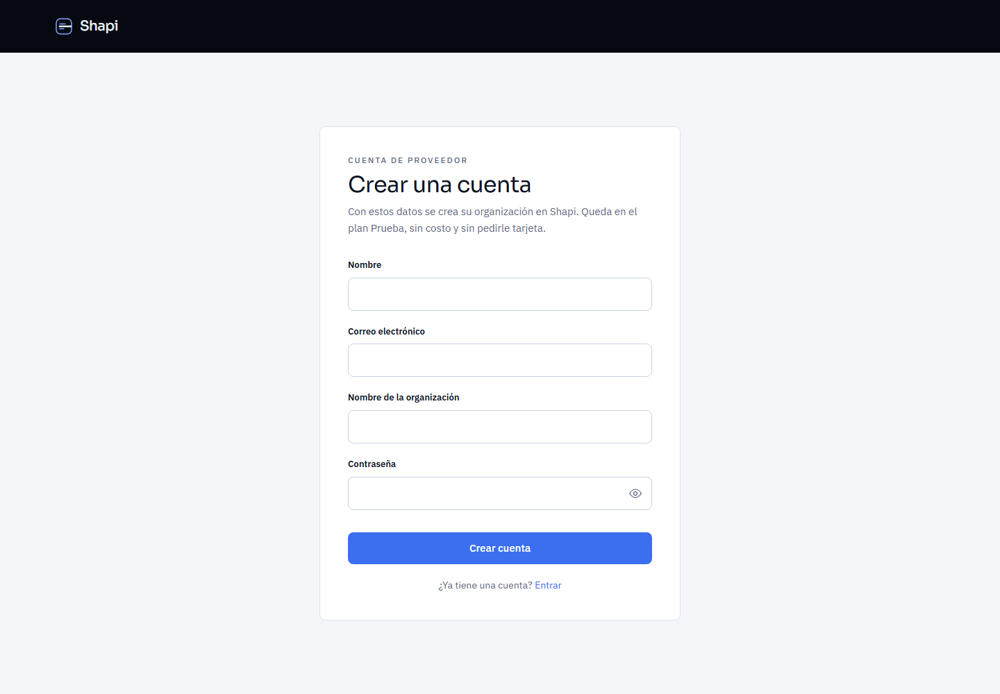

El registro crea al propietario y su organización con el plan Prueba, de 30 días. El siguiente paso es verificar el correo; la cuenta de demostración de Ana ya está verificada.

### 3.2 Verificación del correo

1. Cuando aparezca **Revise su correo**, abra el mensaje recibido y siga el enlace de verificación. En el ambiente local, consulte Mailpit en la dirección del capítulo 2 y seleccione el mensaje de su destinatario. El enlace del proveedor vence en 24 horas. Si caducó o ya fue usado, solicite otro mediante **Enviar el enlace otra vez** en la pantalla de verificación.

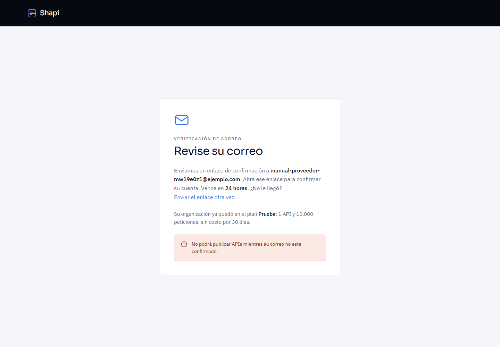

Al verificar correctamente, Shapi inicia la sesión y muestra las APIs. Puede registrar un borrador antes de verificar, pero debe verificar el correo para publicarlo.

### 3.3 Iniciar y cerrar sesión

1. En Shapi seleccione **Entrar**, escriba su correo y contraseña y pulse **Entrar**. Para practicar como propietario use la cuenta de Ana del capítulo 2. El proveedor entra a **APIs**. Si los datos son incorrectos, revise el correo y la contraseña; cinco intentos fallidos bloquean la cuenta durante 15 minutos.

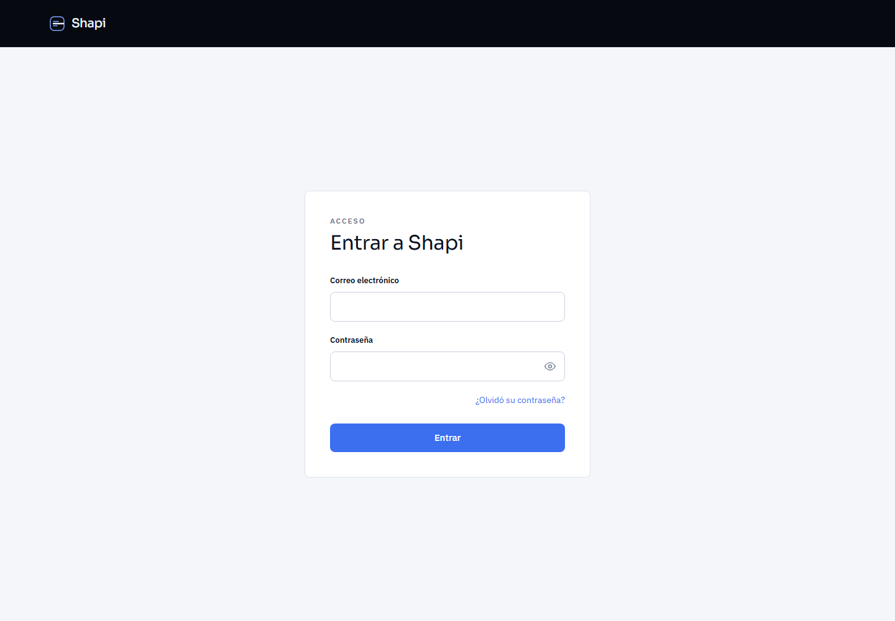

2. Para salir, pulse **Cerrar sesión** al pie de la barra lateral. Su nombre abre **Mi perfil**, donde puede actualizar el nombre y cambiar la contraseña. Al cambiarla deberá proporcionar la contraseña actual.

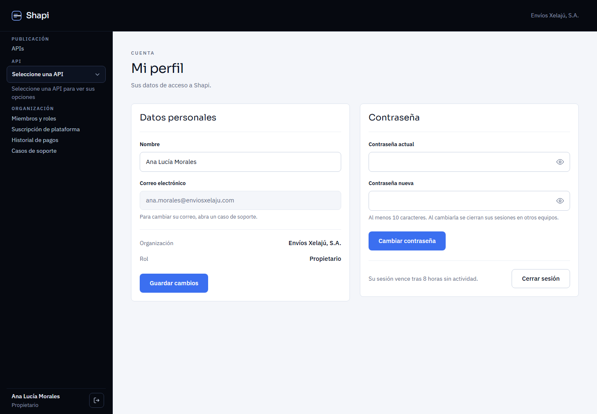

### 3.4 Recuperar la contraseña

1. En el acceso seleccione la recuperación de contraseña, escriba su **Correo electrónico** y pulse **Enviar el enlace**. El aviso no confirma si existe la cuenta. Abra el correo de recuperación y siga su enlace, válido por 60 minutos. Si venció, solicite otro desde esta misma pantalla.

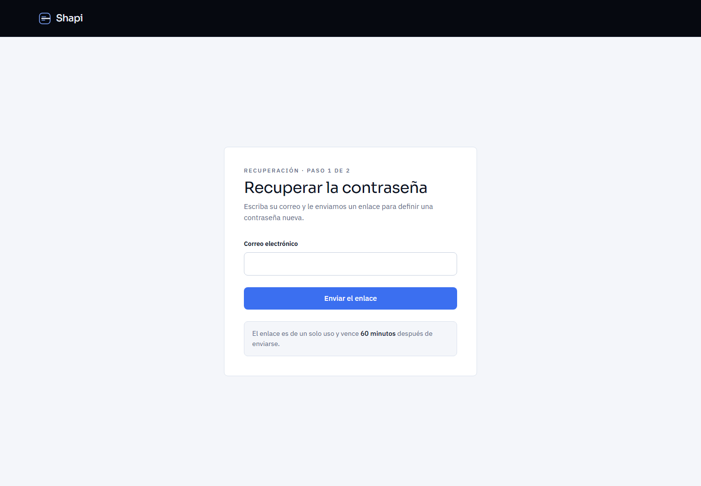

2. En **Definir la contraseña**, escriba la contraseña nueva y pulse **Guardar la contraseña**. El enlace solo se puede utilizar una vez.

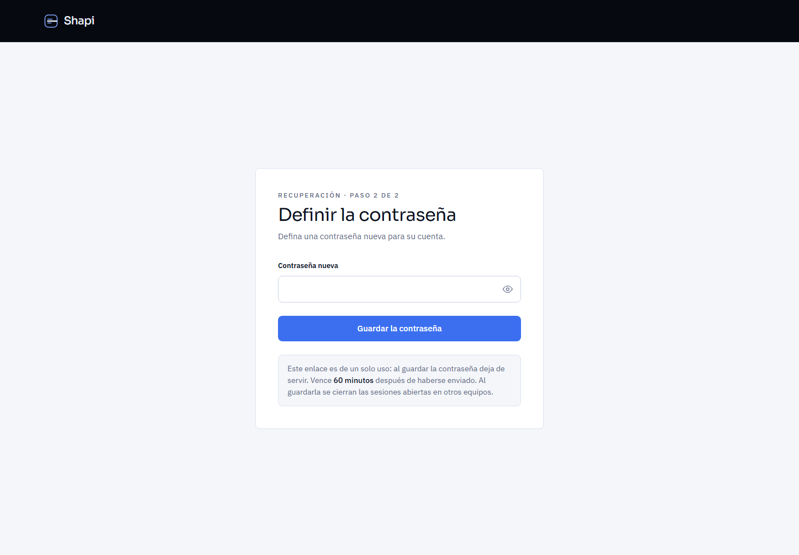

La recuperación correcta cierra las sesiones anteriores e inicia una nueva. Si solo olvidó su contraseña, no necesita registrar otra organización.

### 3.5 Plan de plataforma: contratar, cambiar y renovar

**Perfil:** propietario. El plan de plataforma es el servicio que su organización contrata con Shapi; es independiente de los planes que venderá a sus consumidores.

1. Abra **Suscripción de plataforma** y revise el estado, la vigencia, la próxima renovación y la tarjeta registrada. Desde allí consulte los planes disponibles. Compare precio, cantidad de APIs, peticiones por ciclo, miembros y disponibilidad de dominio propio; seleccione el plan y su vigencia.

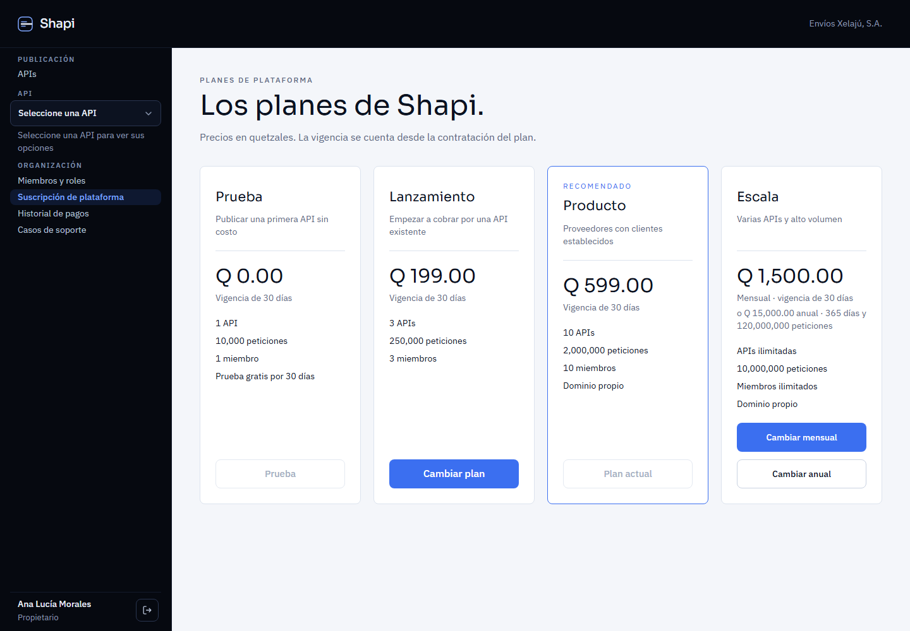

2. Si contrata desde Prueba, revise el importe y el periodo de la contratación, complete los datos de tarjeta y pulse **Pagar … y activar el plan**. Se cobra el precio completo del plan elegido.

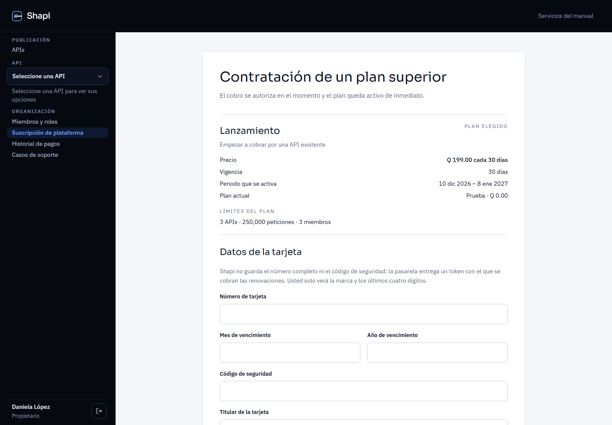

3. Compruebe **Plan activado** y el periodo de servicio. La suscripción queda disponible para consultarla desde el panel.

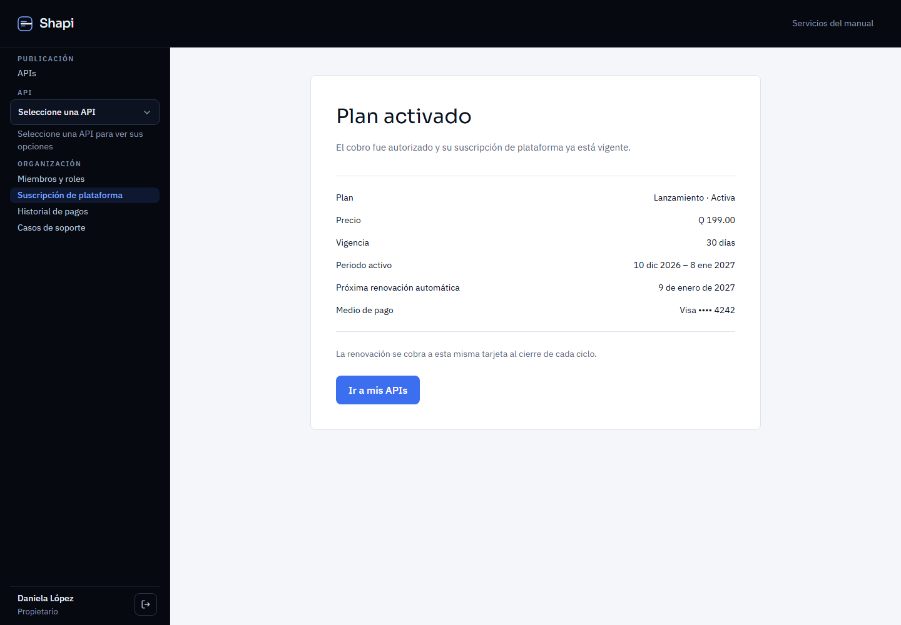

4. Si cambia entre planes de pago, revise el importe de hoy y la próxima renovación. Complete la tarjeta si se solicita y confirme el cambio. Una subida se cobra con el prorrateo mostrado; una bajada se programa para la siguiente renovación y requiere que sus recursos quepan en los límites nuevos. Si el cobro se rechaza, corrija el medio de pago y reintente; el plan vigente no cambia.

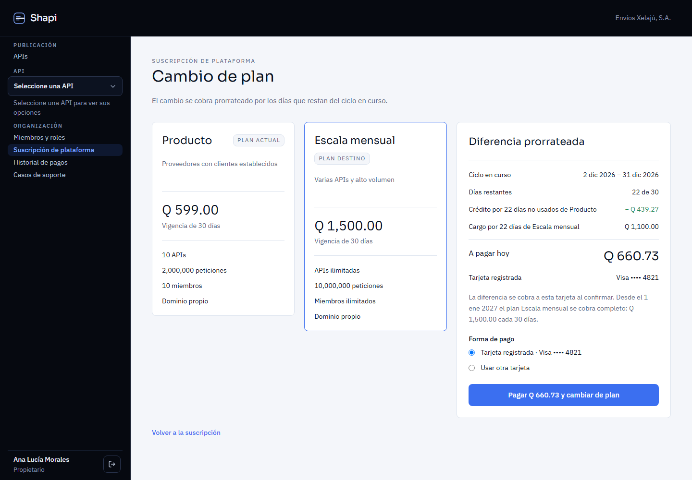

5. Vuelva a **Suscripción de plataforma** para comprobar el resultado. Si está en gracia o suspendida, use **Pagar con otra tarjeta**. Durante los siete días de gracia el servicio sigue disponible; después, la compuerta rechaza el tráfico. Pagar la deuda no elimina una suspensión administrativa: en ese caso debe contactar a soporte. Consulte los cobros en **Historial de pagos**.

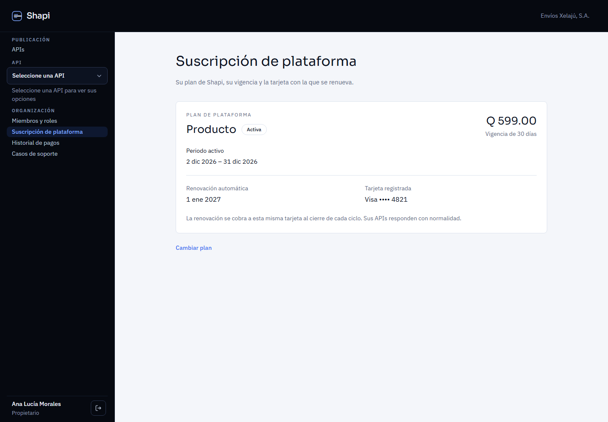

### 3.6 Registrar una API

**Perfil:** propietario o editor. Tenga preparada la dirección de un servidor de origen accesible y un subdominio disponible.

1. Abra **APIs** y pulse **Registrar una API**. Complete **Nombre de la API**, **URL del servidor de origen** y **Subdominio**; este último admite entre 3 y 30 letras minúsculas, números o guiones. Pulse **Registrar y continuar**. Shapi prueba la conexión antes de guardar; si falla, revise la dirección y la disponibilidad del origen.

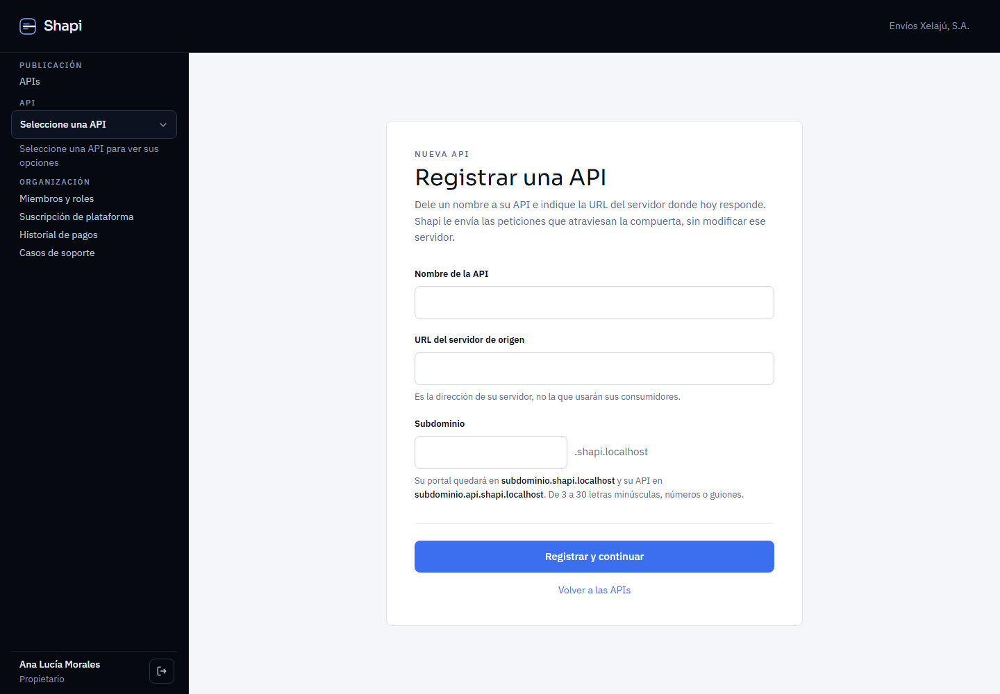

2. Al registrarse, la API queda en borrador y se muestra su secreto de origen una sola vez. Guárdelo antes de **Continuar a la especificación**. Ese secreto identifica las peticiones de Shapi ante su servidor; no es la clave que usan los consumidores. El recuadro de color de esta captura oculta el secreto; en su pantalla verá el valor completo.

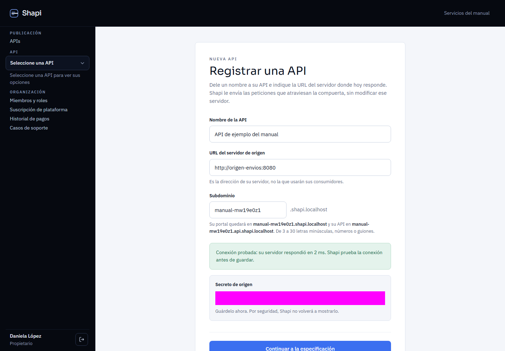

En la demostración, Envíos Xelajú ya tiene una API publicada; puede recorrer su configuración sin registrar otra.

### 3.7 Cargar la especificación OpenAPI

1. Seleccione la API y abra **Especificación**. Arrastre el archivo OpenAPI `.yaml` o `.json`, o selecciónelo con **elíjalo en su equipo**. El archivo no debe superar 2 MB. Espere la confirmación y revise las rutas detectadas; si aparece un error, corrija el archivo y vuelva a seleccionarlo. Use **Continuar a la selección de rutas** para avanzar.

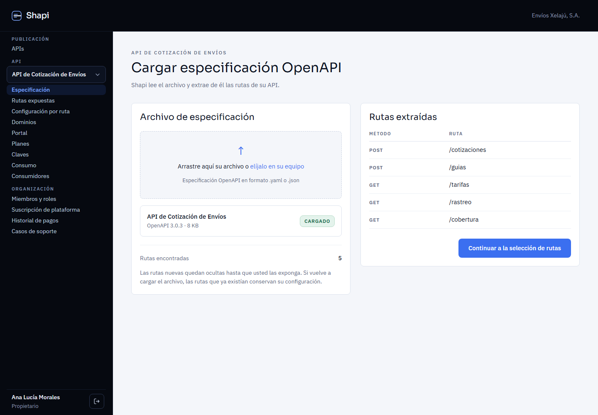

Las rutas nuevas se importan ocultas. Cargar una especificación no las publica automáticamente.

### 3.8 Exponer rutas

1. En **Rutas expuestas**, revise cada método y ruta. Marque **Exponer** para lo que desea ofrecer y **Ocultar** para lo que debe quedar fuera del acceso público. Pulse **Guardar rutas expuestas** y espere el aviso de guardado. Para publicar necesita al menos una ruta expuesta.

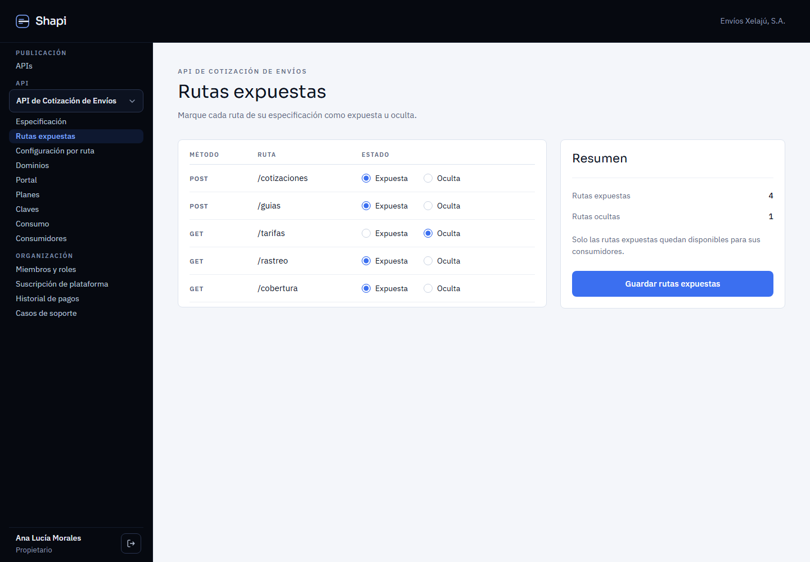

### 3.9 Configurar rutas

1. Abra **Configuración por ruta**. Establezca el **límite por minuto**, la **caché** y el **peso en llamadas** de cada ruta. Pulse **Guardar configuración**. El peso indica cuántas llamadas de la cuota descuenta una petición; el límite por minuto cuenta peticiones. La caché solo se permite para GET. Los cambios se publican en la compuerta en menos de 10 segundos.

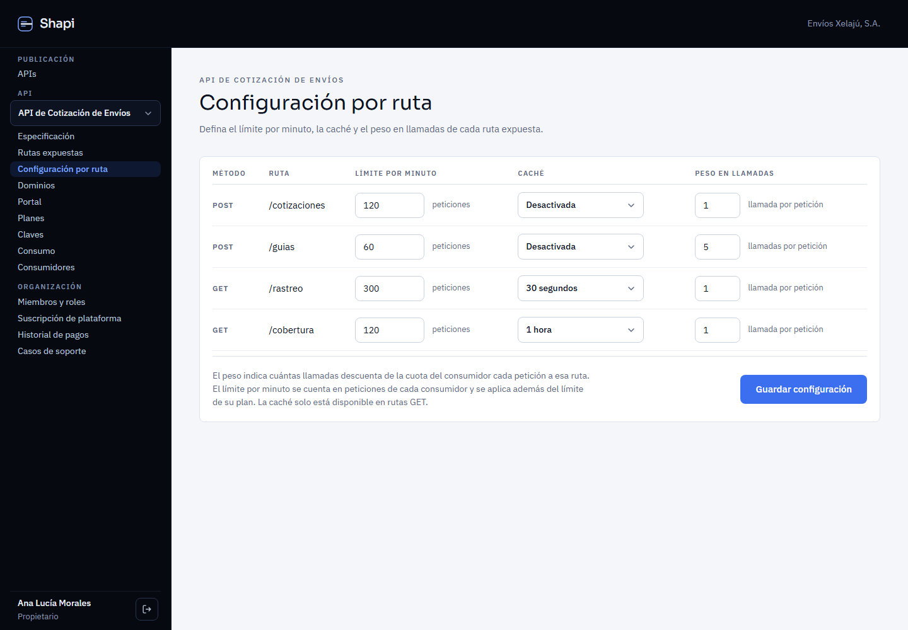

### 3.10 Planes de la API

1. Abra **Planes**, en el grupo de la API seleccionada, para consultar los planes que se ofrecen a sus consumidores. Para agregar uno, pulse **Crear un plan**.

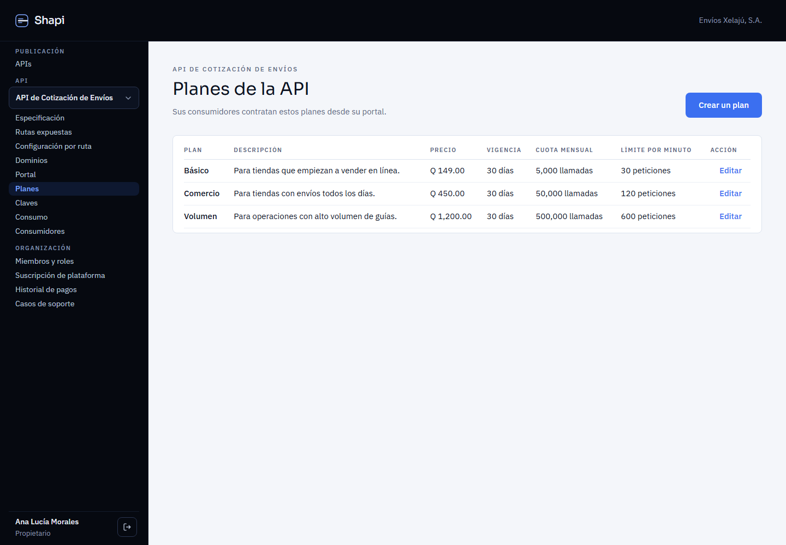

2. Complete nombre, descripción, vigencia, cuota mensual y límite por minuto. Seleccione **Plan gratuito** o indique un precio mayor que cero para un plan de pago. Pulse **Crear plan**; para modificar uno existente abra su edición y use **Guardar plan**. Las cuotas y los límites cambian de inmediato; el precio nuevo se cobra en la próxima renovación. Si un plan tiene suscripciones, retirarlo lo desactiva y conserva su historial.

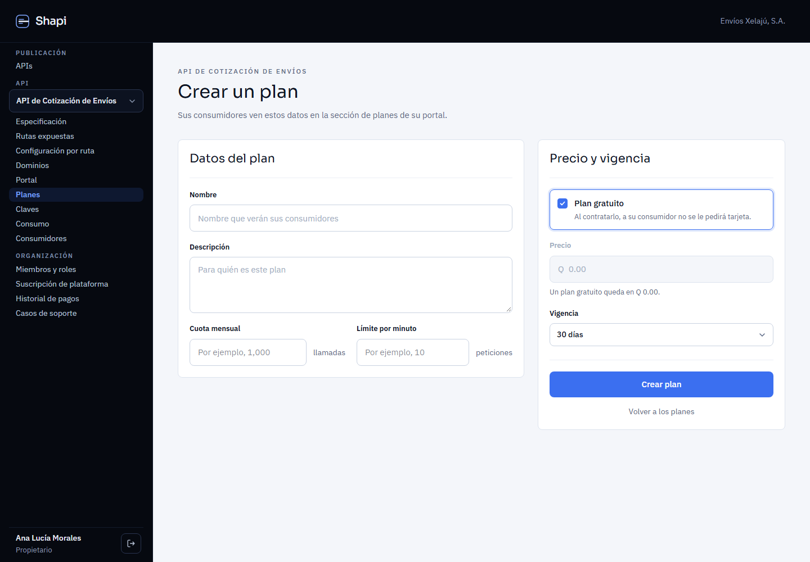

### 3.11 Publicar una API

1. Vuelva a **APIs**. Compruebe que el correo esté verificado, que exista una ruta expuesta y que tenga un plan activo. En la fila de la API pulse **Publicar** y compruebe el estado **Publicada**. Abra el portal desde su dirección para revisar documentación y planes. **Despublicar** retira la disponibilidad pública de esa API; no lo utilice si quiere que los consumidores sigan accediendo.

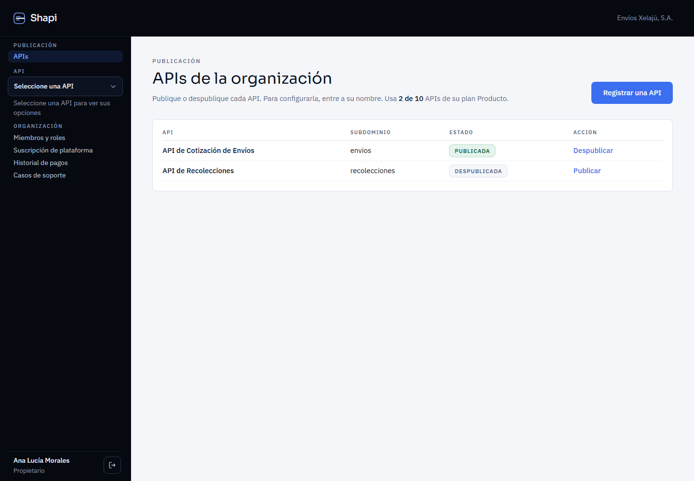

### 3.12 Personalizar el portal

1. En la API abra **Portal**. Ajuste nombre, texto de bienvenida y color principal, y seleccione el logotipo si lo necesita. Compruebe la vista previa y guarde los cambios. Abra el portal publicado para confirmar su marca. Esta configuración pertenece a la API seleccionada.

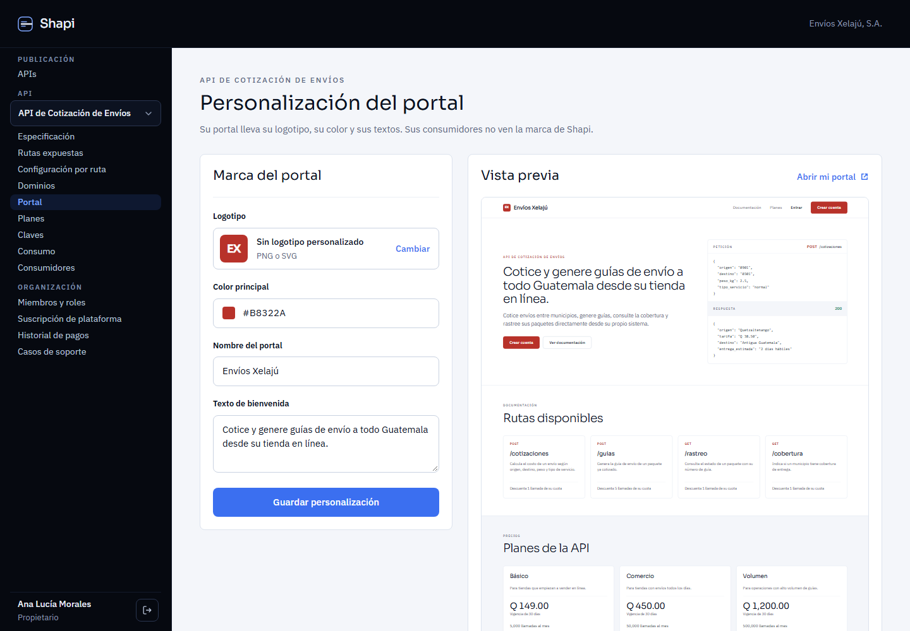

### 3.13 Dominio propio y secreto de origen

1. Abra **Dominios** para consultar las direcciones del portal y de la API. Si el plan permite dominio propio, escriba el dominio y pulse **Conectar dominio**. Copie el CNAME indicado. En el ambiente simulado use **Simular la creación del registro** y luego **Verificar registro DNS**. Compruebe el estado verificado; el certificado se emite con la primera petición al dominio. Si la verificación falla, revise el destino del registro y el motivo indicado.

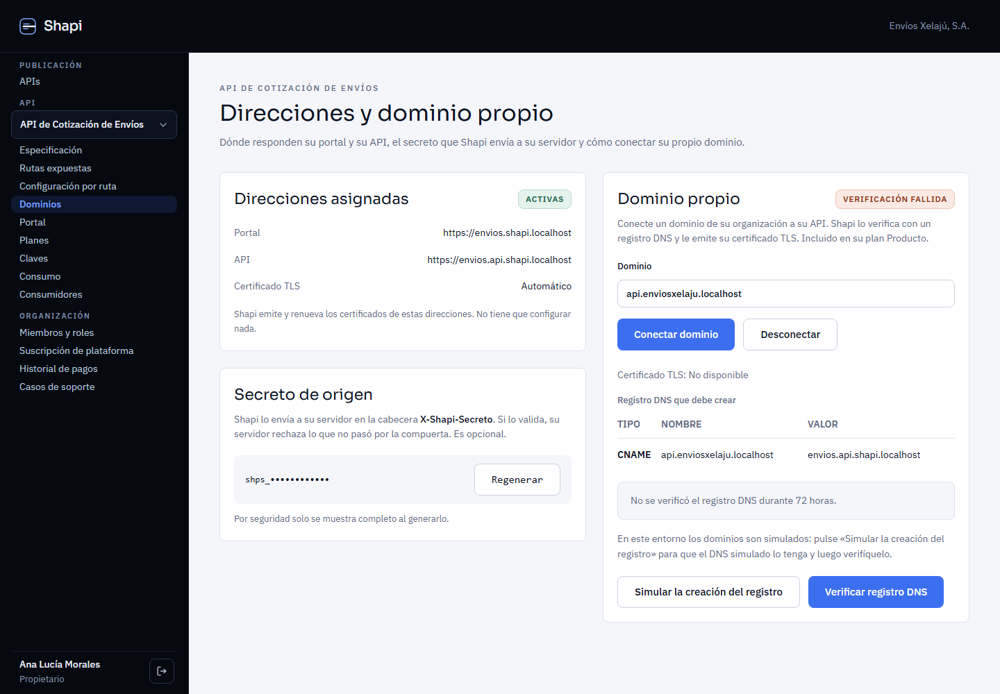

El dominio propio corresponde a la API. **Regenerar**, en la tarjeta del secreto de origen, reemplaza ese secreto y muestra el nuevo una sola vez: actualice también su servidor si valida `X-Shapi-Secreto`. No regenere el secreto durante una simple consulta.

### 3.14 Claves de los consumidores

1. Abra **Claves** en la API y ubique al consumidor y el tipo de clave. La lista muestra valores enmascarados. Para invalidar una clave comprometida use **Revocar** y revise la confirmación antes de aceptarla; desde ese momento deja de funcionar. El proveedor puede revocar, pero la rotación la realiza el propio consumidor desde su portal.

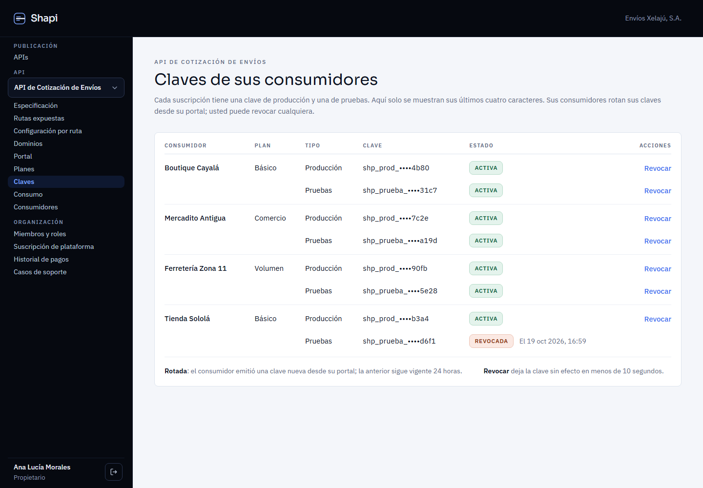

### 3.15 Consumo y consumidores

1. Abra **Consumo** y seleccione el periodo que desea consultar. Revise peticiones, llamadas, latencia, errores y transferencia. Las peticiones son solicitudes; las llamadas son unidades de cuota según el peso de la ruta. El historial se consolida periódicamente, por lo que una petición reciente puede tardar unos segundos en reflejarse.

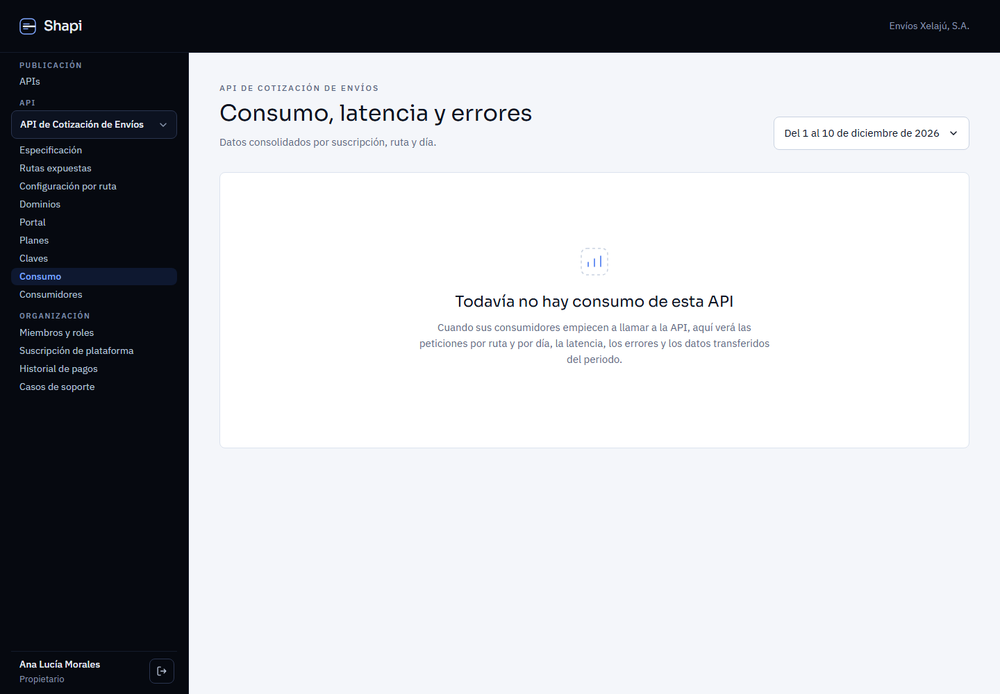

2. Abra **Consumidores** para consultar por cuenta el plan, el consumo y la facturación.

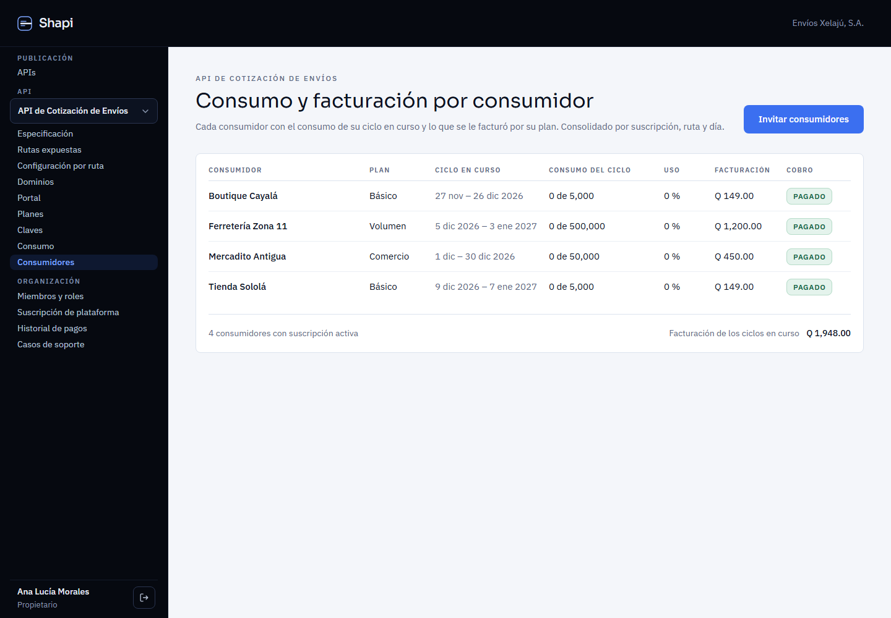

3. Para revisar lo que su organización paga a Shapi, abra **Historial de pagos** en el grupo Organización. Son pagos distintos de los que sus consumidores hacen por sus APIs.

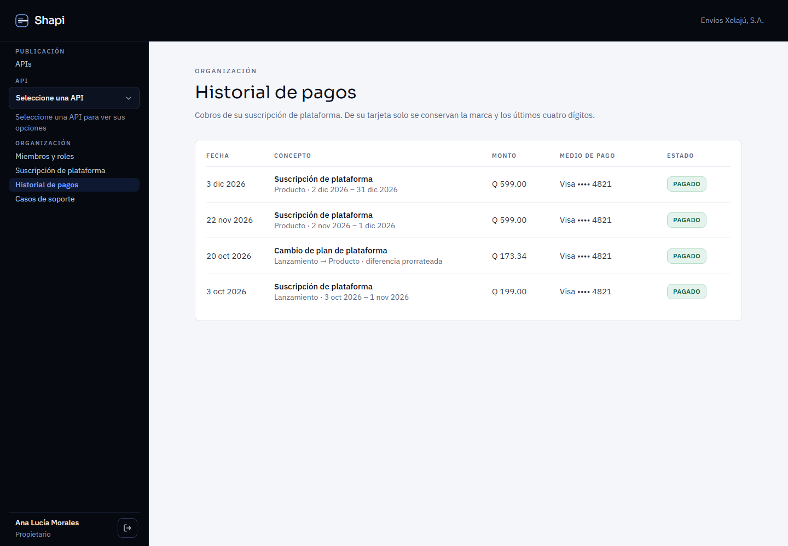

### 3.16 Miembros y roles

**Perfil:** propietario.

1. Abra **Miembros y roles**, escriba el correo de la persona, seleccione **Editor** o **Lector** y pulse **Enviar invitación**. La invitación vence en siete días y está sujeta al límite de miembros del plan. El correo no puede pertenecer a otra organización. En esta misma pantalla puede cambiar el rol o quitar a un miembro mediante su acción y confirmación; no puede quitarse ni cambiar su propio rol de propietario.

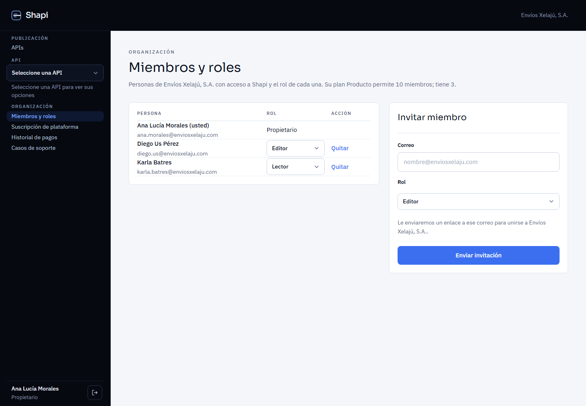

2. La persona invitada debe abrir el correo y seguir el enlace. En **Unirse a …**, debe revisar la organización y el rol, completar nombre y contraseña y pulsar **Aceptar la invitación**. Si la cuenta ya existe sin organización, conserva sus datos de acceso. El ejemplo siguiente utiliza una organización nueva creada para mostrar este formulario.

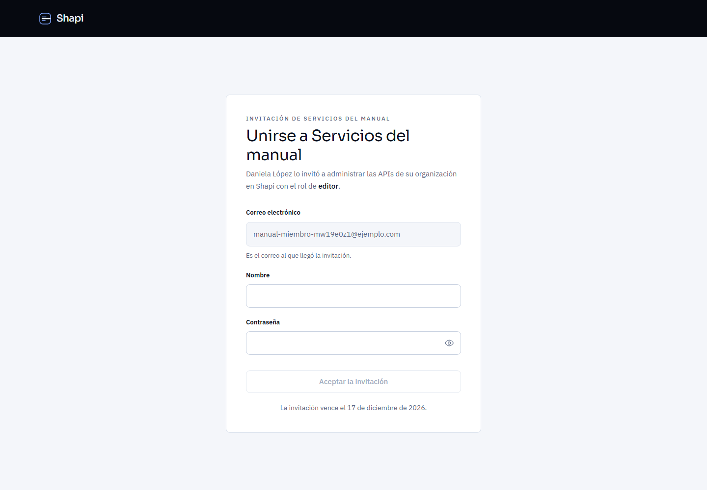

### 3.17 Invitar consumidores

1. Abra **Consumidores** y la opción para invitar consumidores. Escriba el correo y envíe la invitación. La lista permite consultar las pendientes, reenviarlas o cancelarlas. La persona invitada abre el enlace y completa su registro; el correo viene escrito y queda verificado. El enlace vence en siete días. Si ya existe la cuenta o una invitación vigente en la organización, utilice la cuenta o invitación existente.

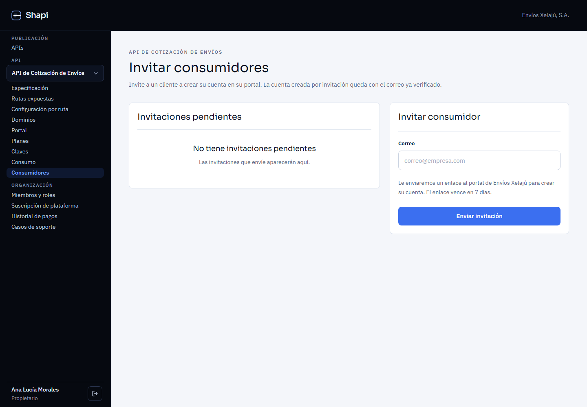

### 3.18 Casos de soporte del proveedor

1. Abra **Casos de soporte**. Para solicitar ayuda complete asunto, descripción y, si corresponde, API afectada; envíe el caso. Describa el problema y el resultado esperado sin incluir claves completas ni contraseñas. La lista permite abrir y seguir sus casos.

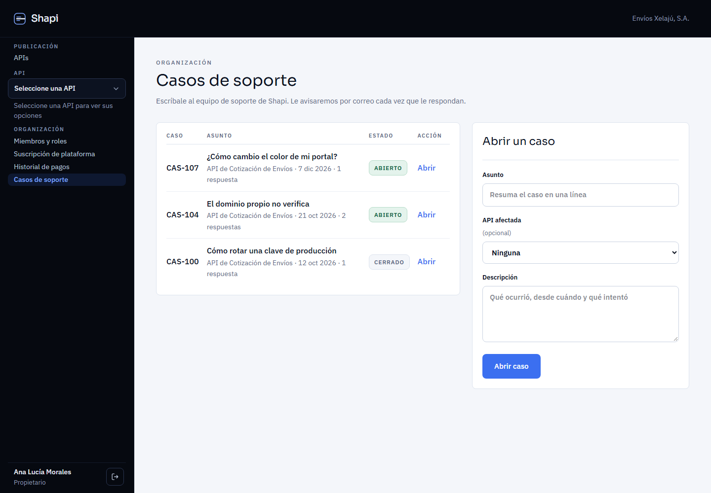

2. Seleccione un caso para leer la conversación. Escriba una respuesta y envíela para agregar información. Cuando el personal de plataforma responda, el proveedor recibe un correo. Soporte o administración cierra el caso cuando termina la atención; el historial queda disponible para consulta.

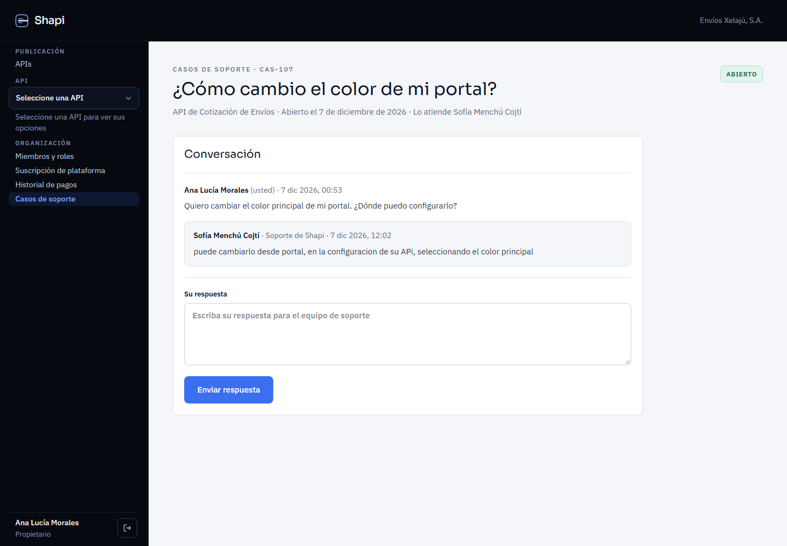

## 4. Consumidor: contratar y utilizar una API

### 4.1 Registro del consumidor y verificación

1. Abra el portal de la API, por ejemplo Envíos Xelajú, y seleccione **Crear cuenta**. Complete nombre, correo, empresa y contraseña y envíe el formulario. Use un correo nuevo para practicar; las cuentas del capítulo 2 ya existen. Si llegó por invitación, conserve el correo que aparece en el formulario.

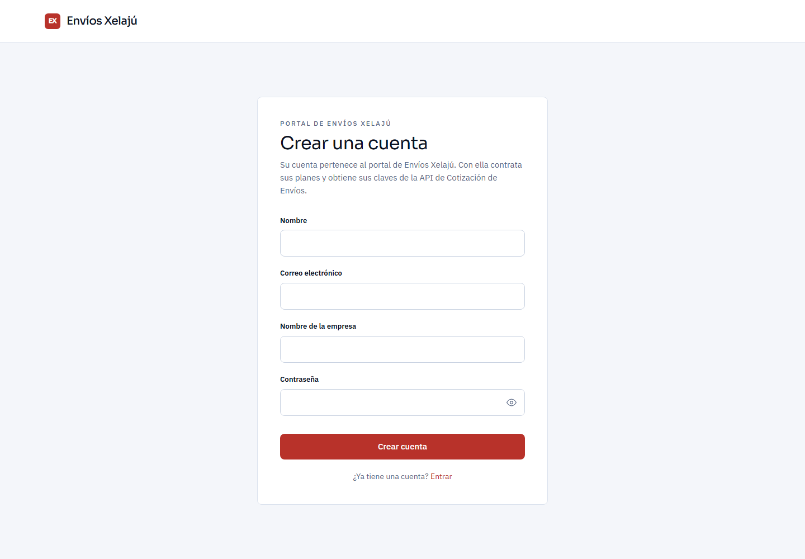

2. Abra el correo de verificación y siga el enlace. Si necesita otro, use el reenvío desde la pantalla de verificación. Debe verificar el correo antes de contratar. En el ambiente de demostración puede consultar el mensaje en Mailpit.

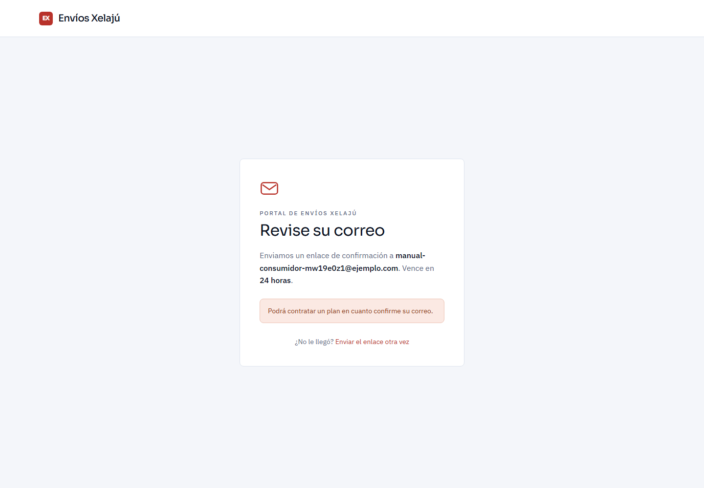

### 4.2 Acceso y recuperación del consumidor

1. En el portal seleccione **Entrar**, escriba su correo y contraseña y confirme. Para consultar la demostración use la cuenta de María José en Envíos Xelajú. Su cuenta se abre en **Suscripción y claves**, o en **Planes** si todavía no tiene una suscripción. Para salir, pulse **Cerrar sesión** en el portal.

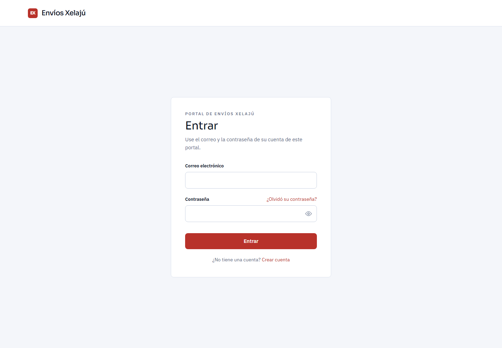

2. Si olvidó la contraseña, abra la recuperación, escriba el correo y pulse **Enviar el enlace**. Abra el mensaje y siga el enlace de un solo uso, válido por 60 minutos. Si venció, solicite otro.

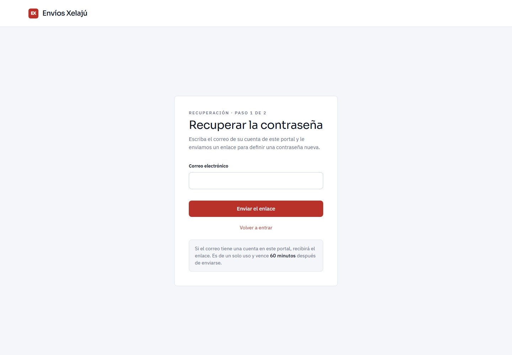

3. En **Definir la contraseña**, escriba la nueva contraseña y pulse **Guardar la contraseña**. La recuperación invalida las sesiones anteriores e inicia una nueva.

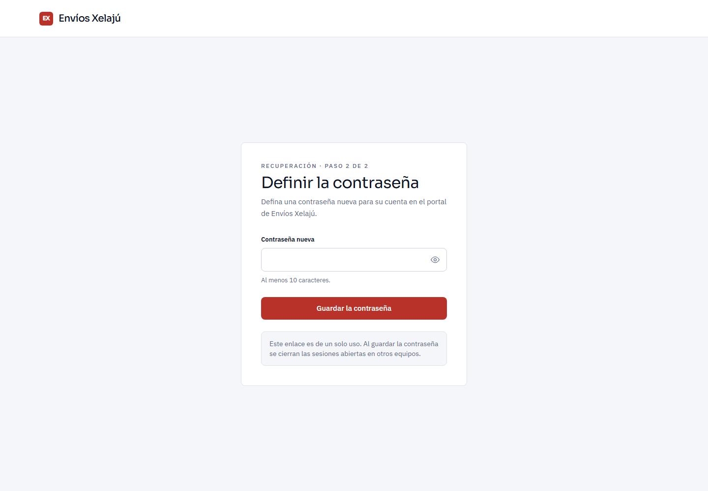

### 4.3 Documentación y consola

1. Abra **Documentación** desde el inicio del portal. Seleccione una ruta para consultar método, dirección, parámetros y respuestas. Solo se muestran las rutas que el proveedor expuso. La URL de la API es distinta de la URL del portal.

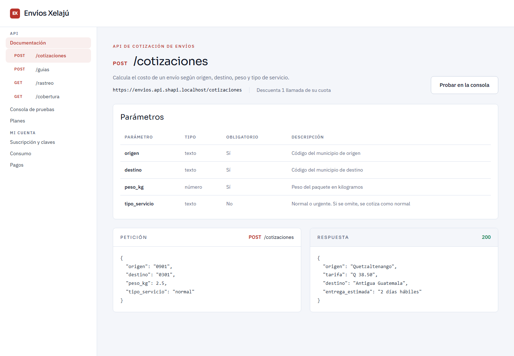

2. Abra **Consola de pruebas**, pegue su clave de pruebas, elija la ruta y complete los parámetros o el cuerpo requerido. Pulse **Enviar petición** y revise el código HTTP y la respuesta. La solicitud se envía al servicio real de demostración. La clave de pruebas permite 10 peticiones por minuto y no descuenta la cuota de producción. Si recibe 429, espere el tiempo indicado antes de repetir.

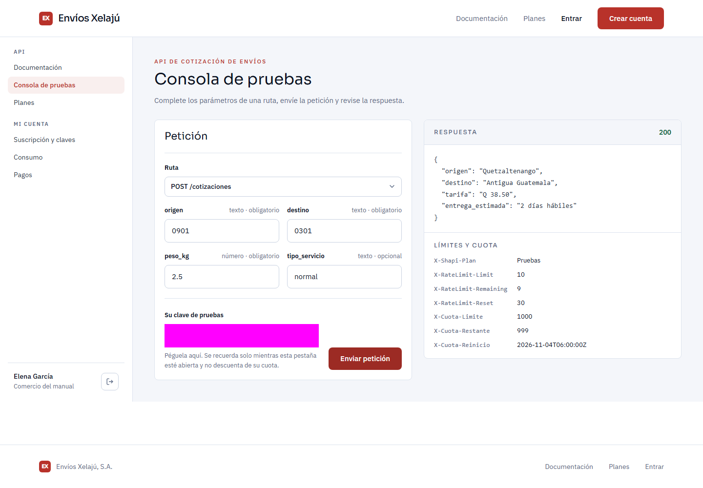

### 4.4 Contratar un plan de API

1. Abra **Planes**, compare precio, vigencia, cuota en llamadas y límite por minuto y seleccione **Contratar**. Necesita una sesión de consumidor y correo verificado. Si ya tiene una suscripción a esa API, use el cambio de plan del apartado 4.8.

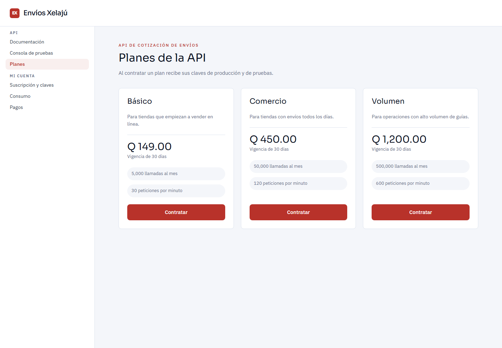

2. Si el plan es de pago, complete número de tarjeta, titular, vencimiento y código de seguridad, revise el total y confirme el pago. Para el ambiente de demostración use la tarjeta del capítulo 2. Si se rechaza, corrija los datos y reintente: una contratación rechazada no crea la suscripción. Un plan gratuito se activa sin cobrar.

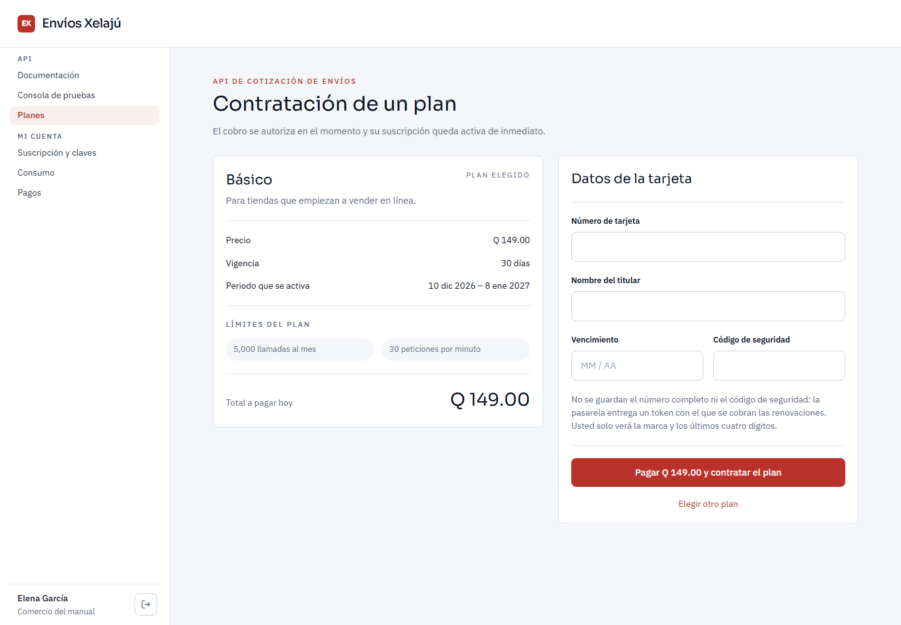

3. En **Plan contratado**, guarde las claves de producción y de pruebas con **Copiar**: se muestran completas una sola vez. Después se consultan enmascaradas en **Suscripción y claves**. Use una clave únicamente con la API a la que pertenece. Los recuadros de color de esta captura ocultan los valores completos para no publicarlos en el manual.

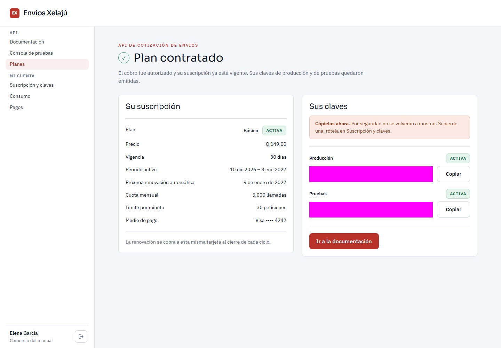

### 4.5 Suscripción y claves: consultar, rotar y revocar

1. Abra **Suscripción y claves**. Revise plan, vigencia, próxima renovación, tarjeta y estado. Conserve sus claves completas en un lugar seguro; no se pueden recuperar desde la lista enmascarada. Use producción para su integración y pruebas para la consola.

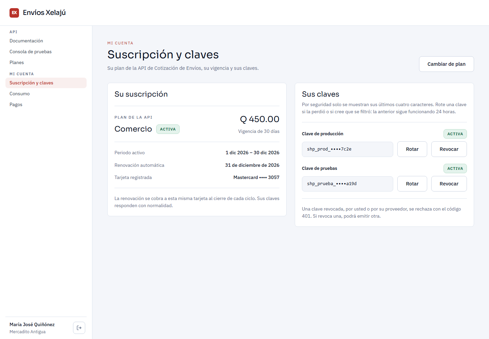

2. Para sustituir una clave activa pulse **Rotar**, revise la confirmación y pulse **Rotar clave**. La anterior sigue funcionando 24 horas; si rota de nuevo durante esa ventana, se invalida la clave rotada más antigua del mismo tipo.

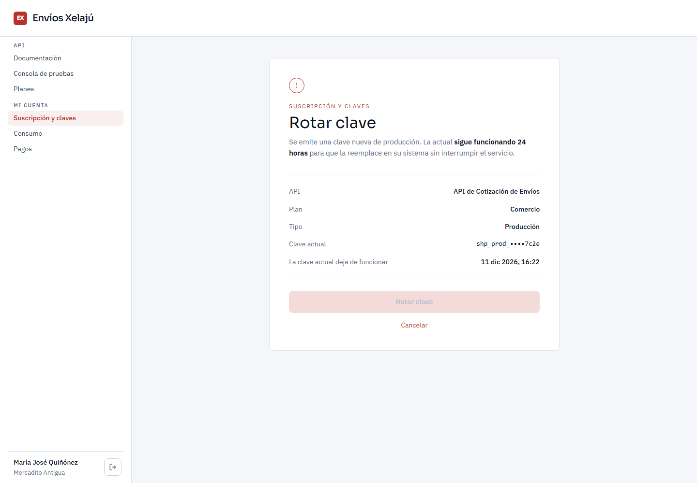

3. En **Su clave nueva de producción** o de pruebas, copie y guarde el valor nuevo, actualice su aplicación y finalice con **Ya la guardé**. Esta es la única ocasión en que puede ver el valor completo. El recuadro de color de la captura lo oculta para este manual.

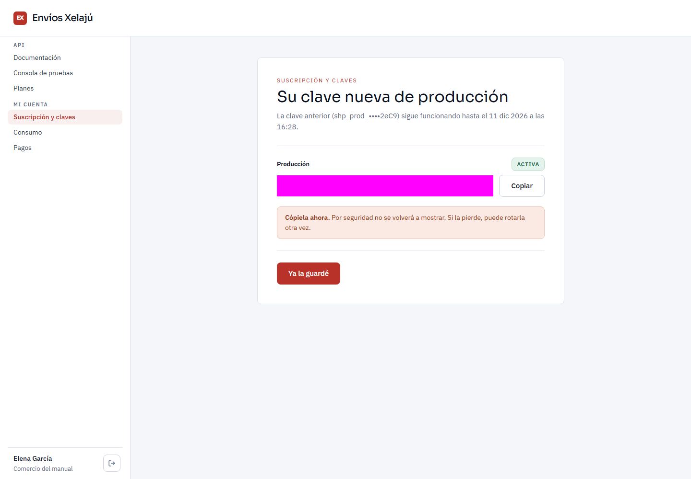

4. Para invalidar inmediatamente una clave pulse **Revocar**, compruebe el tipo y confirme con **Revocar clave**. Las solicitudes con esa clave recibirán 401. Si no queda una clave activa de ese tipo, use **Emitir una clave nueva** y guarde el valor que se muestra una sola vez. Si no desea continuar en una confirmación, use **Cancelar**.

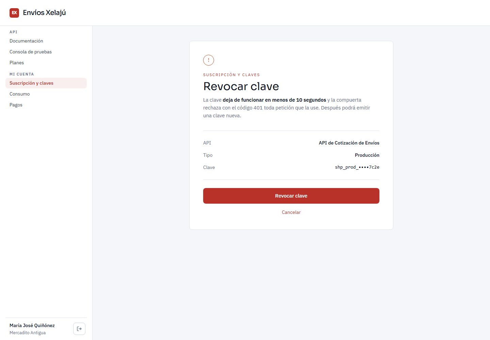

### 4.6 Consumo del consumidor

1. Abra **Consumo** para consultar su ciclo y el detalle por ruta. Compare las llamadas utilizadas con la cuota contratada y las peticiones por minuto con el límite del plan. El peso de cada ruta puede consumir varias llamadas por petición; por eso ambas cifras no siempre coinciden. Si agota la cuota, espere la renovación o evalúe un plan mayor.

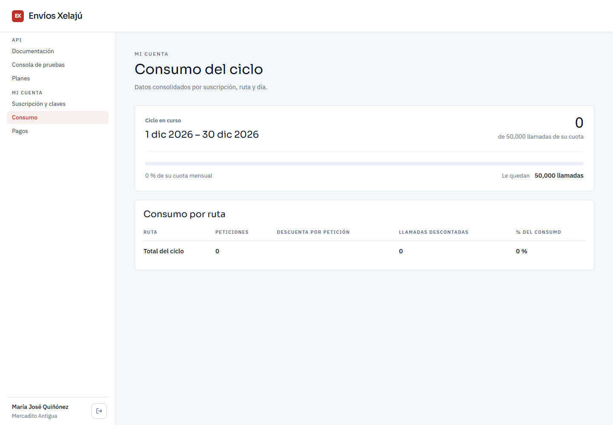

### 4.7 Pagos del consumidor y renovación

1. Abra **Pagos** para consultar fecha, monto, estado y detalle de cada operación. Compare estos registros con su suscripción. Ante una renovación rechazada, abra **Suscripción y claves** y utilice **Pagar con otra tarjeta**. Durante la gracia de siete días conserva el acceso; una vez suspendida, la compuerta responde 403 hasta que autorice el pago. Si la API está suspendida por el proveedor o Shapi, contacte al proveedor.

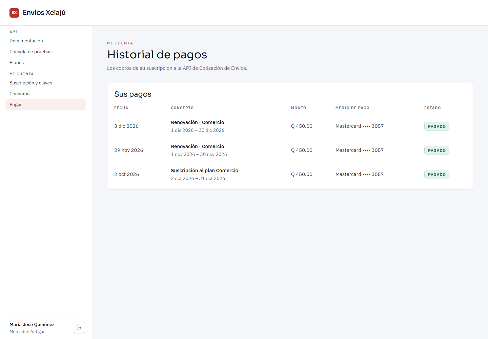

### 4.8 Cambiar el plan de API

1. En **Suscripción y claves**, pulse **Cambiar de plan**. Seleccione el nuevo plan y revise el resumen antes de confirmar. Una subida se aplica de inmediato con el prorrateo correspondiente. Una bajada se programa para la próxima renovación, sin cobro inmediato. Si existe un cambio programado, su suscripción muestra la fecha y permite **Cancelar cambio programado**. Si un pago falla, el plan vigente se conserva.

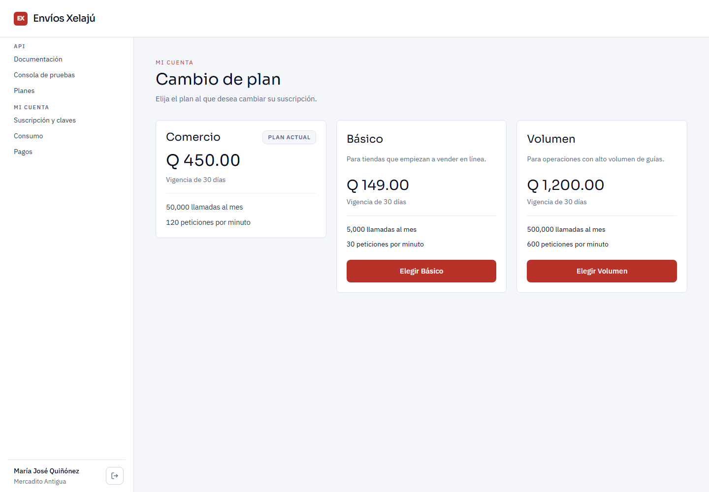

## 5. Administración y soporte

Ingrese por **Entrar** en Shapi con una cuenta de plataforma. El administrador puede modificar planes, organizaciones, pagos y cuentas. Soporte atiende casos y consulta los datos permitidos; no modifica recursos del proveedor. Ambos pueden consultar estado y bitácora.

### 5.1 Planes de plataforma

**Perfil:** administrador.

1. Abra **Planes de plataforma** para consultar los planes y sus límites. Seleccione **Crear un plan** o **Editar** en el plan que corresponda.

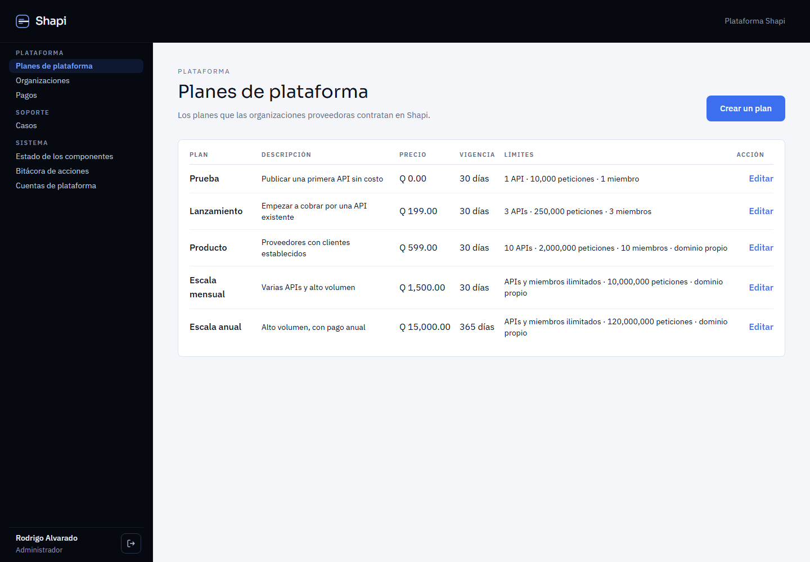

2. Defina nombre, descripción, precio, vigencia, límites de APIs y miembros, cuota de peticiones y dominio propio. Guarde el plan. Desde la edición de un plan existente puede desactivarlo; los registros conservan su historial. Los cambios de cuota se aplican de inmediato y los precios nuevos, en la renovación.

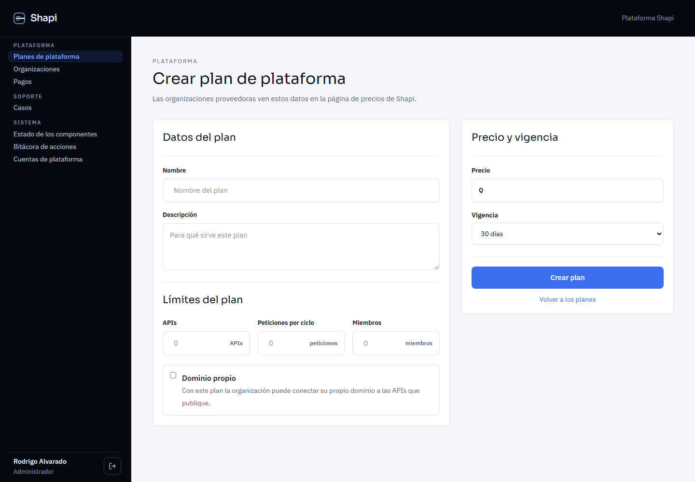

### 5.2 Organizaciones: consultar, suspender y reactivar

**Consulta:** administrador y soporte. **Cambios:** administrador.

1. Abra **Organizaciones** y localice el proveedor. Revise propietario, plan, ciclo y estado efectivo. Distinga una suspensión administrativa de una causada por falta de pago: la reactivación administrativa no resuelve una deuda.

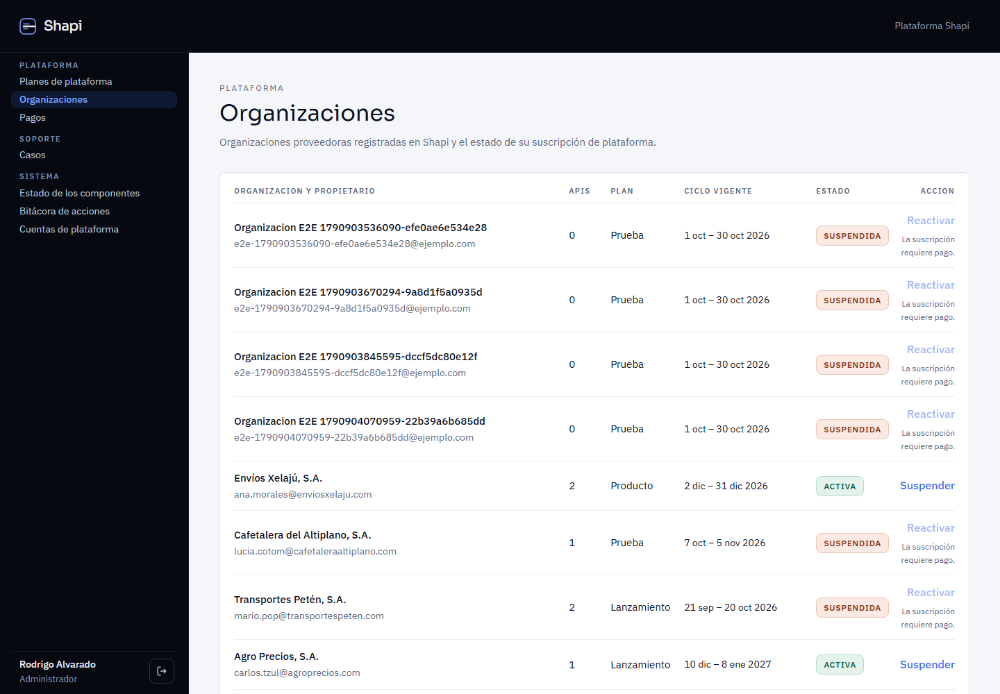

2. Para suspender, pulse **Suspender** en la organización correcta. Lea el resumen, escriba el motivo administrativo y confirme solo si corresponde. El propietario recibe un correo y la compuerta deja de atender sus APIs en menos de 10 segundos. Para retirar la suspensión administrativa utilice **Reactivar** en la lista; cuando la suspensión es solo por falta de pago, el botón aparece deshabilitado con su explicación.

### 5.3 Pagos de plataforma y reversión

**Perfil:** administrador.

1. Abra **Pagos de plataforma** para localizar un pago por organización y comprobar estado, fecha y monto. Los registros corresponden a los planes que Shapi vende a sus proveedores.

2. En un pago autorizado seleccione **Revertir**, lea la organización, el monto y las consecuencias y confirme únicamente si la devolución es correcta. El pago queda revertido y, si cubría el ciclo vigente, la suscripción entra en gracia. Use **Cancelar** para volver sin modificar el pago.

### 5.4 Cuentas de plataforma

**Perfil:** administrador.

1. Abra **Cuentas de administración y soporte**. En **Crear cuenta** complete nombre, correo y rol y pulse **Crear cuenta**. La persona recibe un enlace para definir su contraseña, válido por siete días. Estas cuentas se crean aquí; no se usa el registro público del proveedor.

Para impedir el acceso de una cuenta, use **Desactivar** en su fila; se revocan sus sesiones. **Activar** vuelve a habilitarla. No puede desactivar su propia cuenta. Los roles existentes aparecen en solo lectura.

2. La persona debe abrir el enlace del correo, completar **Contraseña nueva** y pulsar **Guardar la contraseña**. Después de guardarla inicia su sesión con el rol asignado. Si el enlace venció o ya se utilizó, debe comunicarse con el administrador.

### 5.5 Atender casos

**Perfiles:** administrador y soporte.

1. Abra **Casos de soporte**, revise los estados y seleccione el caso que atenderá. También puede registrar uno a nombre de una organización cuando recibió la solicitud por otro medio; indique la organización, el asunto y la descripción.

2. En la conversación pulse **Asignarme el caso** si está sin asignar. Revise el resumen de organización y la API afectada en solo lectura. Escriba la respuesta y pulse **Enviar respuesta**; el proveedor recibe una notificación por correo. Cuando termine la atención use **Cerrar el caso**. Un caso cerrado conserva su conversación para consulta.

### 5.6 Estado de los componentes

1. Abra **Estado de los componentes**. Revise cada servicio, su condición y la latencia p95 de la compuerta. La pantalla se actualiza automáticamente cada 30 segundos. Si hay un componente degradado, comunique su nombre y el mensaje al responsable técnico. El p95 describe el tiempo por debajo del cual se encuentra el 95 % de las mediciones de la ventana mostrada.

En demostración, el administrador dispone además del reloj de negocio. Adelantarlo puede renovar o suspender suscripciones de todo el ambiente: coordine cualquier ensayo con el responsable. Soporte consulta el estado sin manejar ese reloj.

### 5.7 Bitácora

1. Abra **Bitácora**, establezca el rango de fechas y aplique el filtro disponible. Consulte actor, acción, organización y fecha para reconstruir lo ocurrido, y use la paginación cuando haya más resultados. Es un registro de consulta: no se pueden editar ni eliminar entradas. Diferencie la fecha de la acción de las fechas de vigencia de una suscripción.

## 6. Resolver problemas habituales

| Situación | Qué revisar y cómo continuar |
|---|---|
| No puede entrar | Compruebe que esté en Shapi o en el portal correcto, su correo y contraseña. Si olvidó la contraseña, solicite el enlace. Tras cinco intentos fallidos espere 15 minutos. Una cuenta desactivada requiere atención del administrador |
| No llega el correo | En demostración revise el destinatario en Mailpit. Use el reenvío o solicite un enlace nuevo si venció. Si persiste, comuníquelo al responsable técnico |
| No puede publicar | Verifique correo, ruta expuesta, plan activo, límite de APIs y estado de la organización |
| No aparece una opción | Revise su rol. El editor no administra miembros ni el cobro de plataforma; soporte no modifica datos de proveedores |
| Pago rechazado | Revise el motivo y use otra tarjeta. En demostración la tarjeta 4242 del capítulo 2 autoriza el cobro. Un fallo de servicio permite reintentar más tarde |
| Petición rechazada con 401 | Compruebe la clave, la API y si fue revocada o venció su ventana de rotación. No puede recuperar una clave completa desde su valor enmascarado |
| Petición rechazada con 403 | Revise estado de la API, organización y suscripción; también que la ruta esté expuesta. Pague si corresponde o contacte al proveedor o soporte |
| Petición rechazada con 429 | Espere antes de reintentar y consulte límites por minuto y cuota del ciclo. La clave de pruebas tiene un límite propio de 10 peticiones por minuto |
| Error 502 o 504 | El origen no pudo atender la petición o agotó el tiempo. Informe al proveedor con la ruta y la hora del error |
| Error de conexión en pantalla | Espere y use **Reintentar**. Si continúa, abra un caso con los pasos y el mensaje mostrado |
| Aviso de certificado o sitio inaccesible | Solicite al responsable técnico verificar el ambiente y el certificado local según el manual técnico; no es un error de sus credenciales |

## 7. Referencias

- [Manual técnico](manual-tecnico.md): instalación, direcciones, siembra y operación del ambiente.
- [Casos de uso](specs/05-casos-de-uso.md): flujos de registro, contratación y administración.
- [Roles y permisos](specs/04-roles-y-permisos.md): acciones permitidas por perfil.
- [Interfaz](specs/11-interfaz.md#3-catálogo-de-pantallas): catálogo de pantallas del sistema.
